# Vườn 12 · Xưởng dưới trăng — audit v3 (t34 · t35 · t36)

v3: thêm vào mỗi slide ba mục [Thẩm mỹ], [Cân bằng bố cục], [Hướng dẫn tương tác] (lỗi và đề xuất), chấm theo `calibration.md`. Ảnh lúc mở lấy từ `all/` (bộ ảnh chụp đồng loạt), ảnh lúc kết lấy từ `g12/`.

Nguồn bằng chứng:
- Ảnh và log DOM từ lượt chơi v1 (dev server 5179, Playwright, ảnh trong `g12/`).
- Toàn bộ chữ đọc từ `tram-34/35/36.json`, `toolkit.json`, `site.json`, đối chiếu với code scene.
- Lúc làm v2, dev server đã tắt (`ERR_CONNECTION_REFUSED`). Em không bật lại vì brief là read-only, nên v2 không có ảnh mới.
- Không có lỗi console trong mọi lượt chơi v1.
- Quy ước nhãn lỗi: [GP] Gameplay · [LO] Layout · [CC] Câu chữ · [LG] Logic thông tin.

---

## Trạm 34 · Nền tảng sáng tạo (II·16)
**Mục tiêu học (1 câu):** Chọn nền tảng theo đúng việc, biết mỗi lượt tạo tốn bao nhiêu credit, làm theo trình tự nháp → chốt → phóng nét, và gắn nhãn AI, xin phép trước khi đăng.

**Mạch hiện tại:** 1 Chợ đêm dưới trăng → 2 Đường đi của một asset → 3 Credit là nước trong bình → 4 Thật và giả → quiz → ensō.

**Vấn đề mạch:**
- Slide 2 dùng khái niệm credit trước khi slide 3 giải thích ("Chỉ phóng nét bản cuối để không đốt credit"; "ngân sách credit").
- Slide 2 đã có bước "Kiểm tra quyền & gắn nhãn AI", slide 4 nói lại đúng ý đó. Hai thẻ mang về đặt lệch chỗ: checklist quyền/nhãn nằm ở slide 2, brief lại nằm ở slide 3.
- Quiz chỉ hỏi phần quyền/nhãn. Phần chọn nền tảng và credit (2/4 slide) không được kiểm.

**Mạch đề xuất:** 1 Chợ (chọn sạp theo việc) → 2 Bình credit (mỗi lượt tốn bao nhiêu) → 3 Đường đi (vì vậy phải nháp rẻ trước; thẻ "Brief 1 trang") → 4 Thật và giả (trước khi đăng; thẻ "Checklist trước khi đăng") → quiz → ensō.

**Kicker / tóm tắt / thẻ mang về hiện tại:**
- Kicker: "Xưởng có trăm cây đục — thợ giỏi biết cầm cây nào cho nhát nào." → **lỗi:** trạm không có slide nào vẽ cây đục (chỉ có chợ, lối cát, bình, cầu). Ẩn dụ không được giải mã ở đâu cả. → **đề xuất:** "Chợ có nhiều sạp, bình chỉ có chừng ấy nước — chọn sạp theo việc, và đừng để bình cạn giữa chừng."
- Tóm tắt (ensō): "Chọn đúng cây đục cho đúng nhát — và luôn biết mình đang tiêu bao nhiêu nước trong bình." → **lỗi:** chỉ nói bằng hai ẩn dụ chồng nhau (đục, nước) và bỏ hẳn nửa trạm về quyền/nhãn. → **đề xuất:** "Chọn nền tảng theo việc, nháp rẻ trước khi tốn credit, và gắn nhãn AI, xin phép trước khi đăng."
- Thẻ mang về: "Brief 1 trang cho video AI" (hiện ở slide 3) · "Checklist trước khi đăng asset AI" (hiện ở slide 2). → **lỗi:** đặt lệch chỗ như đã nói. Dòng đầu thẻ brief viết in hoa toàn bộ ("BRIEF VIDEO AI — 1 TRANG"). → **đề xuất:** brief đặt ở slide Đường đi (bước 1). Checklist đặt ở slide Thật và giả. Tiêu đề viết thường "Brief 1 trang cho video AI"; chỗ trống viết thường trong ngoặc, vd. "[tên sản phẩm]", vì đã có tô màu.

Điểm: Gameplay 5/10 · Layout 5/10 · Câu chữ 6/10 · Logic thông tin 5/10 · Thẩm mỹ 6/10 · Cân bằng 5/10 · Hướng dẫn 4/10

### 34-1 · Chợ đêm dưới trăng   ·   Mức: Sửa nhẹ   ·   Ưu tiên: P1 (dạy sai)
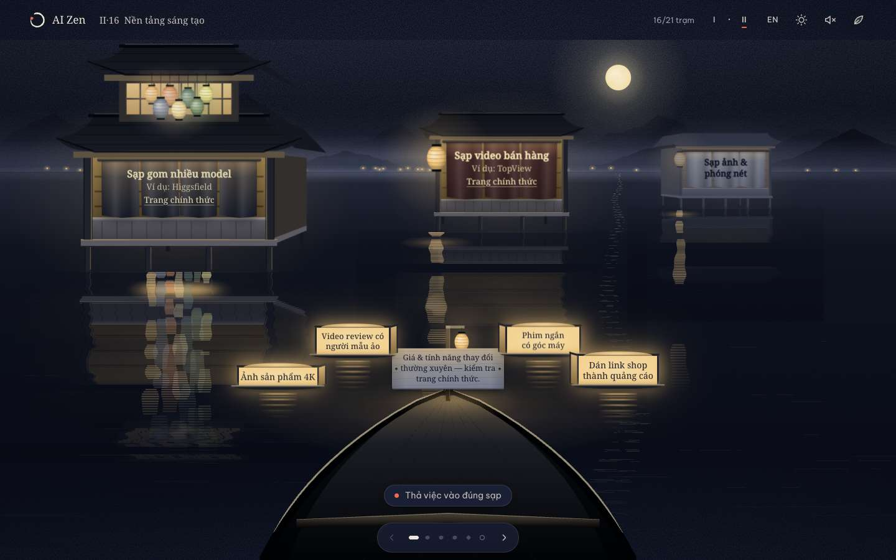
Trạng thái kết: 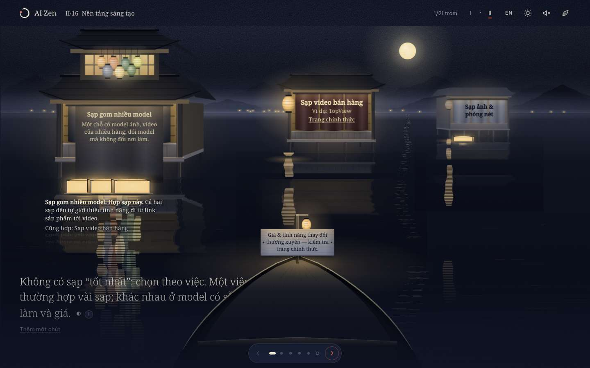
**Hiện tại**
- Thấy: con thuyền giữa hồ đêm, 3 sạp ở ba độ xa, 4 đèn hoa đăng ghi việc. Ở giữa mũi thuyền có tấm biển "Giá & tính năng thay đổi…", và mắt nhìn vào đó trước tiên (`t34-1-a`).
- Làm: prompt "Thả việc vào đúng sạp". Kéo một đèn tới sạp. Nếu hợp, sạp bùng sáng, rèm vén lên, chữ hiện trên nước. Nếu sai, đèn trôi về thuyền.
- Chữ trên màn (theo thứ tự):
  - Rèm: "Sạp gom nhiều model · Ví dụ: Higgsfield · Trang chính thức"; "Sạp video bán hàng · Ví dụ: TopView"; "Sạp ảnh & phóng nét".
  - Khi hợp (DOM): "Sạp ảnh & phóng nét. Hợp sạp này. Phóng nét (upscale) là việc chính của sạp ảnh; sạp gom cũng có công cụ ảnh. Cũng hợp: Sạp gom nhiều model" + fact "Ngày 28/04/2026, Freepik đổi tên thành Magnific…".
  - Khi sai: "Sạp video bán hàng — Sạp này không chuyên việc đó — thử sạp khác."
  - Insight: "Không có sạp “tốt nhất”: chọn theo việc. Một việc thường hợp vài sạp; khác nhau ở model có sẵn, cách làm và giá."
  - Thêm một chút: "Mô tả tính năng ở đây là lời các hãng tự giới thiệu (◇)…"

**Lỗi**
1. [GP] Dữ liệu dạy sai: cả 4 việc đều có `fits` gồm "hub" (photo4k, review, film, link). Thả hết vào sạp gom là luôn đúng, nên hình ảnh nói ngược với insight "Không có sạp tốt nhất". Cuối lượt, sạp gom ôm 3/4 đèn (`t34-1-d-done`).
2. [LO] Insight bị mũi thuyền che: "Một việ… model có s…" (`t34-1-d-done`). Bóng chữ phản chiếu tạo một mảng chữ ngược đọc không được. Sạp ảnh không có link "Trang chính thức". Trên phone, biển giá chồng lên rèm sạp gom (`t34-1-p`).
3. [CC]
   - "model" không được giải thích, trong khi người xem không làm kỹ thuật.
   - "Hợp sạp này. … sạp gom cũng có công cụ ảnh. Cũng hợp: Sạp gom" nói "sạp gom" hai lần.
   - "Sạp video bán hàng — Sạp này không chuyên việc đó — thử sạp khác": hai gạch nối, chữ "Sạp" lặp, và không nói vì sao không hợp.
   - Insight nhắc "giá", nhưng slide không có thông tin giá nào.
4. [LG] Biển "Giá & tính năng thay đổi thường xuyên" nằm giữa khung, nên được đọc trước cả nhiệm vụ. Insight nói "khác nhau ở … giá", nhưng hành động không hề cho thấy khác biệt về giá.
5. [Thẩm mỹ] (TM 3, như calibration) Ba sạp có mái, rèm, phản chiếu dài trên nước — đọc được và có chiều sâu.
   - 4 "đèn hoa đăng" là hộp giấy chữ nhật sáng đều như nhãn UI: không đế, không ngọn lửa, vệt phản chiếu yếu.
   - Biển "Giá & tính năng…" là panel xám chữ nhật kiểu card, đặt ngay giữa mũi thuyền.
   - Sạp ảnh ở xa (x≈1060–1240, y 220–340) phẳng, không có đèn riêng.
6. [Cân bằng bố cục] (CB 3)
   - **Lúc mở:** sạp chiếm 1/3 trên (y 70–400). 4 đèn và biển giá dồn thành một hàng ngang y≈520–630 trên trục giữa. 1/3 dưới là mũi thuyền đen.
   - **Lúc kết:** insight 3 dòng (x 48–660, y 670–780) bị mũi thuyền cắt (`t34-1-d-done`). Chữ trên nước (x≈1010–1310, y 380–520) nằm ở góc đối diện, mắt phải nhảy chéo cả khung.
7. [Hướng dẫn tương tác] Cử chỉ thật: kéo đèn tới sạp (hoặc chạm đèn rồi chạm sạp, cách này chỉ ghi trong aria).
   - Đang có: H3 (đích thả là sạp, to và rõ), H6 (sạp bùng sáng khi đúng; đèn trôi về khi sai).
   - Đang thiếu: H1 (đèn không có chấm son, trông như nhãn tĩnh); H2 (không có vệt chỉ hướng kéo); H4 (không đếm 0/4).
   - H5: prompt "Thả việc vào đúng sạp" mất ngay ở lần chạm đầu (`station.ts:153`; DOM sau thao tác chỉ còn "1/21 trạm").
   - H6 khi sai không nói phải làm gì. Không có H7.
   - Lần đầu: em kéo đúng ngay vì sạp to và đèn nằm sát nước. HD 3.

**Đề xuất sửa**
- Gameplay: sửa dữ liệu để mỗi sạp thắng ít nhất một việc, và hiển thị hai mức hợp: **rực** = chuyên việc này, **mờ** = làm được nhưng không chuyên.
  - "Phóng nét ảnh chụp sẵn lên 4K": sạp ảnh rực, sạp gom mờ.
  - "50 video bán hàng từ link shop": sạp video rực, sạp gom mờ.
  - "Phim ngắn đổi góc máy từng cảnh": chỉ sạp gom rực.
  - "Video review có người dẫn ảo": sạp video rực, sạp gom mờ.
- Layout: insight đặt lên vùng nước trống phía trên bên trái. Bỏ bóng chữ phản chiếu. Biển giá dời xuống cọc nhỏ ở mép thuyền, chữ nhỏ hơn. Thêm link cho sạp ảnh.
- Câu chữ viết sẵn:
  - prompt "Kéo từng đèn tới sạp làm tốt việc đó"
  - rèm "Sạp gom nhiều model — một chỗ có nhiều ‘bộ máy’ AI tạo ảnh, video của nhiều hãng"
  - hợp rực "Sạp này chuyên việc này." · hợp mờ "Sạp gom cũng làm được, nhưng không chuyên."
  - sai "Không hợp: sạp video bán hàng không cho chỉnh góc máy từng cảnh."
  - insight "Không có sạp tốt nhất: sạp chuyên làm một việc thật tốt, sạp gom làm được nhiều việc. Chọn theo việc bạn cần." (22 từ)
  - Thêm một chút "Tính năng ở đây là lời các hãng tự giới thiệu (◇). Hãy thử gói miễn phí với đúng việc của bạn trước khi trả tiền."
- Thẩm mỹ:
  - Vẽ đèn hoa đăng thật: đế bẹ chuối hình sen, chụp giấy có ngọn lửa nhỏ, chữ mực trên chụp, vệt phản chiếu dài đứt quãng.
  - Biển giá thành cọc gỗ nhỏ có chữ khắc ở mép mũi thuyền.
  - Sạp ảnh có rèm và đèn riêng như hai sạp kia; mái có viền trăng (học ánh sáng 19-2).
- Bố cục:
  - Đèn xếp theo đường cong từ mũi thuyền ra xa: gần to, xa nhỏ, x 300→1100, y 660→520, không thành một hàng.
  - Biển giá xuống mép phải mũi thuyền (x≈900, y≈790).
  - Insight đặt trên vùng nước tối trên-trái (x 48–560, y 420–520). Chữ trên nước luôn hiện ngay dưới sạp vừa thả.
- Hướng dẫn:
  - Mỗi đèn chưa thả có chấm son kèm vầng sáng thở trên chụp (H1).
  - Khi nhấc đèn, chân cột ba sạp hiện vòng sáng mờ (H3), kèm một vệt nước chấm mờ từ đèn tới sạp gần nhất (H2).
  - Mép thuyền ghi "0/4 đèn đã thả" (H4).
  - Prompt theo bước: "Kéo một đèn tới sạp làm tốt việc đó" → sau đèn 1: "Còn 3 đèn" → khi sai: "Sạp này không làm việc đó — kéo sang sạp khác".
  - Đứng yên 6 s: đèn kế tiếp nhích ra khỏi thuyền 8px rồi về.
  - Vùng chạm đèn ≥ 44×44 (hiện 132×41).

### 34-2 · Đường đi của một asset   ·   Mức: Làm lại   ·   Ưu tiên: P2
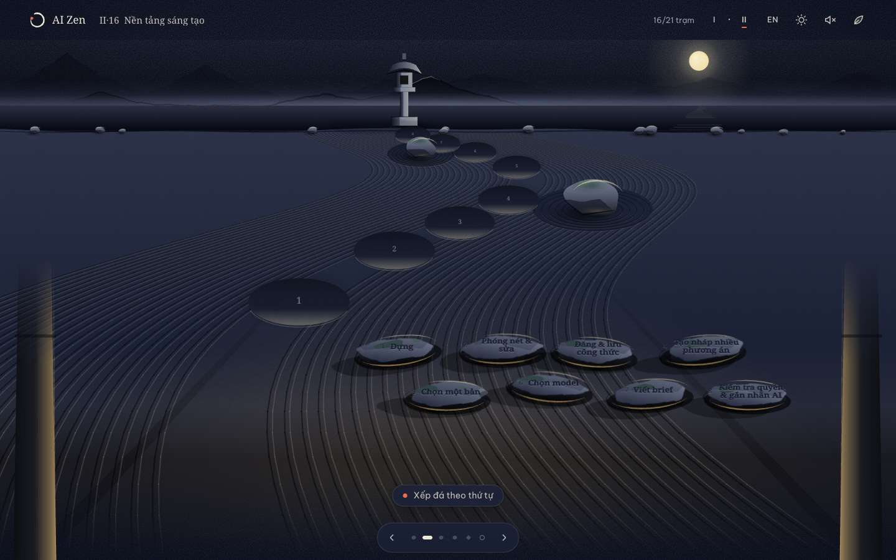
Trạng thái kết: 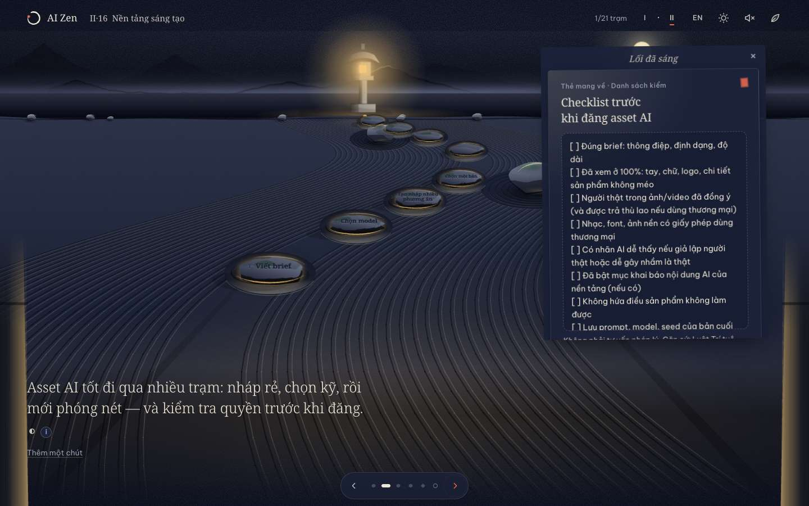
**Hiện tại**
- Thấy: lối cát chữ S có 8 hốc đánh số, cuối lối là đèn đá. Dưới đó là 8 viên đá xáo trộn, mỗi viên mang một số (`t34-2-a`).
- Làm: prompt "Xếp đá theo thứ tự". Chạm từng viên: đúng thì viên bay vào hốc kế tiếp; sai thì viên lắc và hiện gợi ý. Xong thì đèn đá thắp và thẻ checklist mở ra.
- Chữ trên màn:
  - Đá: "1 Dựng · 2 Phóng nét & sửa · 3 Đăng & lưu công thức · 4 Tạo nháp nhiều phương án · 5 Chọn một bản · 6 Chọn model · 7 Viết brief · 8 Kiểm tra quyền & gắn nhãn AI".
  - Khi sai (DOM): "Chưa đúng chỗ. Gợi ý: Brief rõ thì model đoán ít, bạn tốn ít lượt làm lại."
  - Khi đúng: "4. Chọn một bản — Đặt các bản cạnh nhau, chấm theo brief chứ không theo cảm hứng nhất thời."
  - Insight: "Asset AI tốt đi qua nhiều trạm: nháp rẻ, chọn kỹ, rồi mới phóng nét — và kiểm tra quyền trước khi đăng."
  - Thêm một chút: "Thứ tự này là một gợi ý của AI Zen, không phải quy chuẩn…"
  - Thẻ: "Lối đã sáng · Checklist trước khi đăng asset AI" (8 dòng, có thanh cuộn).

**Lỗi**
1. [GP] Đây là quiz đoán thứ tự, không có hậu quả. Số trên đá là phím tắt ngẫu nhiên, còn hốc cũng đánh số 1–8, nên người xem đặt "1 Dựng" vào hốc 1 là sai ngay (`t34-2-b-wrong`).
2. [LO] Nhãn trên các đá ở xa nhỏ và tối, gần như không đọc được ("Chọn một bản" ở hốc 4, `t34-2-c-mid`). Thẻ checklist che 1/3 bên phải và cả mặt trăng (`t34-2-d-done`). Trên phone, đá sáng trên nền cát sáng nên chữ mờ (`t34-2-p`).
3. [CC]
   - "asset" là tiếng Anh sót ở nhãn slide, insight và tiêu đề thẻ.
   - Gợi ý khi sai nói *lý do của hốc đang trống* ("Brief rõ thì…") chứ không nói về viên vừa chạm ("Dựng"), nên người xem không biết mình sai ở đâu. Câu này dùng chuỗi chung `stepWrong`, còn chuỗi riêng `wrongHint` của trạm bị bỏ.
   - "chấm theo brief" mơ hồ (chấm điểm? chấm chọn?).
   - Ở insight, chữ "trạm" là ẩn dụ chưa giải mã, lại trùng với "trạm" của app.
4. [LG] Bước "Phóng nét" giải thích bằng "đốt credit", trong khi credit đến slide sau mới được dạy. Ý "kiểm tra quyền" trùng với slide 4.
5. [Thẩm mỹ] (TM 2)
   - Cát cào đơn sắc xanh xám phủ khoảng 80% khung, không đổi sắc độ theo xa gần.
   - 8 viên đá là đĩa xám bo tròn có chữ in, xếp lưới 2×4 như hàng nút (calibration (a)).
   - Hốc là elip tối phẳng có số. Hai cột cổng là dải nâu dọc phẳng.
   - Đèn đá đích ở xa và nhỏ (x 620–680, y 90–210), không thành hero.
6. [Cân bằng bố cục] (CB 2)
   - **Lúc mở:** 1/4 trên là dải bờ và núi mỏng. 8 đá dồn thành khối lưới ở x 560–1270, y 560–700. Góc dưới trái (x 90–540, y 560–840) trống. Tảng rêu (x≈910–990, y 300–360) là vật duy nhất ở giữa phải.
   - **Lúc kết:** thẻ checklist (x 965–1360, y 80–600) chiếm 1/3 phải và che trăng. Insight ở góc dưới trái, nên hai khối chữ lớn nằm ở hai góc đối nhau (`t34-2-d-done`).
7. [Hướng dẫn tương tác] Cử chỉ thật: chạm đá theo thứ tự (hoặc kéo đá vào hốc, hoặc bấm phím số).
   - Đang có: H3 (hốc có số), H6 (đá lắc khi sai, có dòng gợi ý), H4 tạm (hốc đã lấp).
   - Đang thiếu: H1, H5 (prompt mất sau lần chạm đầu), H7.
   - Số phím tắt in trên đá, đặt cạnh số của hốc, khiến người lần đầu đặt "1 Dựng" vào hốc 1 và sai ngay (`t34-2-b-wrong`). HD 2.

**Đề xuất sửa**
- Gameplay (concept mới, **3 ngã rẽ có hậu quả**): người xem dắt một đèn giấy (= bản nháp) dọc lối cát, bên cạnh là bình credit nhỏ đã học ở slide trước.
  - Ngã 1 "Phóng nét ngay" / "Nháp 4 bản nhỏ trước": chọn phóng nét ngay thì một gáo lớn đổ khỏi bình.
  - Ngã 2 "Chọn bản theo brief" / "Chọn bản mình thích nhất lúc đó": chọn theo cảm hứng thì đèn lạc vào lối cụt và phải quay lại.
  - Ngã 3 "Kiểm quyền & gắn nhãn rồi đăng" / "Đăng luôn cho kịp": đăng luôn thì gió thổi tắt đèn trên mặt hồ (bài bị gỡ).
  - Đi đúng cả ba thì đèn đá cuối lối thắp. Danh sách 8 bước chuyển vào thẻ mang về.
  - Nếu vẫn giữ kiểu xếp đá: bỏ số trên đá ở desktop, và gợi ý khi sai phải nói về chính viên vừa chạm.
- Layout: thẻ mang về thu thành một mảnh giấy nhỏ dưới đèn đá; chạm vào mới mở.
- Câu chữ viết sẵn:
  - nhãn "Đường đi của một ảnh/video AI" · prompt "Dắt đèn nháp qua lối cát — chọn ở mỗi ngã rẽ"
  - hậu quả 1 "Phóng nét bản chưa chốt: tốn 30 phần nước cho một bản có thể bỏ đi."
  - hậu quả 3 "Đăng khi chưa kiểm quyền: bài bị gỡ, công sức đổ theo."
  - insight "Nháp rẻ trước, chốt theo brief, phóng nét bản cuối, kiểm quyền rồi mới đăng — đổi thứ tự là tốn credit hoặc mất bài." (24 từ)
  - Thêm một chút "Đây là thứ tự AI Zen gợi ý, không phải quy chuẩn. Phần mềm dựng dùng cái nào bạn quen cũng được."
- Thẩm mỹ:
  - Nếu giữ cảnh: đá thành đá cuội tự nhiên, khác cỡ, có rêu và bóng tiếp xúc, chữ khắc mờ trên mặt đá, không viền nút. Cát ấm ở gần (ánh từ cổng) và lạnh dần về xa, có sương trên hồ. Đèn đá đích to gấp 1,5 lần, có vầng sáng, làm hero.
  - Với concept 3 ngã rẽ: lối cát tách nhánh rõ ở 3 điểm, mỗi nhánh có cọc gỗ khắc chữ.
- Bố cục:
  - Lối S chiếm 2/3 giữa khung, đèn đá hero ở 1/3 trên-phải (x≈1000, y≈180).
  - Đá rời rải tự nhiên dọc vệt cát dưới-trái (x 150–600, y 600–800), không xếp lưới.
  - Thẻ mang về thu thành mảnh giấy nhỏ dưới đèn đá. Insight đặt trên mặt hồ trên-trái (x 48–600, y 110–190).
- Hướng dẫn:
  - Đèn nháp (concept mới) mang chấm son thở (H1). Ở mỗi ngã rẽ, hai nhánh có cọc ghi lựa chọn và vệt cát sáng mờ dẫn tới (H2/H3).
  - Góc trên trái ghi "Ngã 1/3" (H4).
  - Prompt: "Kéo đèn nháp tới ngã rẽ đầu" → "Chọn một nhánh" → "Đi tiếp tới ngã 2".
  - Đứng yên 6 s: đèn nhích 8px về phía nhánh.
  - Bỏ số phím tắt trên đá ở desktop.

### 34-3 · Credit là nước trong bình   ·   Mức: Sửa nhẹ   ·   Ưu tiên: P1 (thông báo sai, phone không có nhãn)
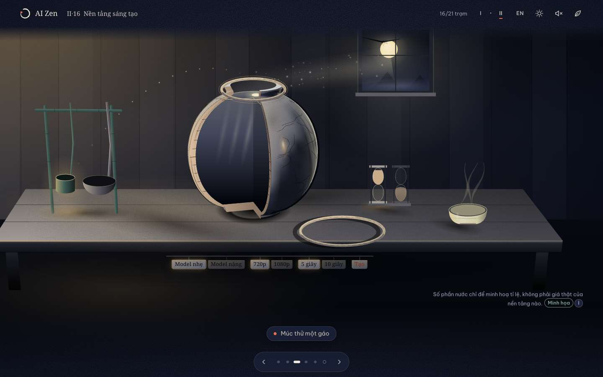
Trạng thái kết: 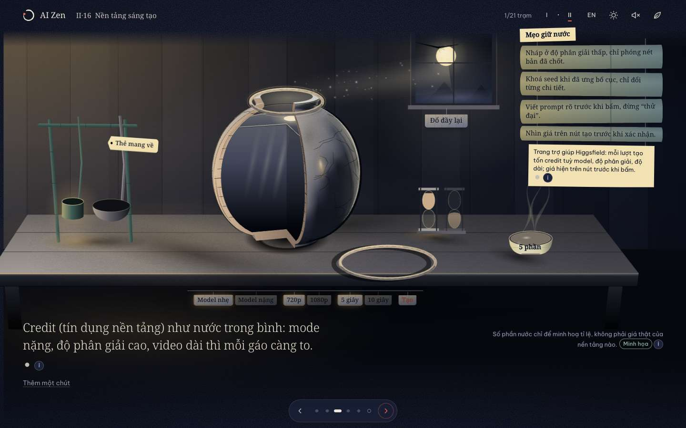
**Hiện tại**
- Thấy: một bình men rạn bổ một phần tư, giá muôi, hai vòng cổ, hai đồng hồ cát, một chén trà. Dưới mép bàn có hàng thẻ gỗ để chọn (`t34-3-a`).
- Làm: prompt "Múc thử một gáo". Kéo muôi vào miệng bình (hoặc chọn thẻ rồi bấm "Tạo"): nước rót vào chén, mực nước trong bình hạ xuống. Lượt nhẹ + 720p + 5 giây tốn 5 phần. Lượt nặng + 1080p + 10 giây tốn 33 phần. Có nút "Đổ đầy lại".
- Chữ trên màn:
  - Thẻ "Model nhẹ · Model nặng · 720p · 1080p · 5 giây · 10 giây · Tạo"; ghi chú "Số phần nước chỉ để minh hoạ tỉ lệ…".
  - Sau gáo đầu: chén ghi "5 phần" · thanh tre "Mẹo giữ nước" (4 mẹo) · fact "Trang trợ giúp Higgsfield: mỗi lượt tạo tốn credit tuỳ model, độ phân giải, độ dài; giá hiện trên nút trước khi bấm." · nhãn "Thẻ mang về".
  - Insight: "Credit (tín dụng nền tảng) như nước trong bình: model nặng, độ phân giải cao, video dài thì mỗi gáo càng to."
  - Khi không đủ: "Bình cạn. Hết credit thì phải chờ kỳ sau hoặc mua thêm."

**Lỗi**
1. [GP]
   - Insight hiện ngay sau gáo **đầu tiên** (`made === 1`), trước khi người xem so lượt nhẹ với lượt nặng, nên insight được nói ra chứ chưa được rút ra.
   - Nút "Nhìn xuống cổ bình" là một cử chỉ thừa, không dạy gì.
2. [LO]
   - Cột nước gần như đen: ở mức 95/100 không nhìn ra mực nước (`t34-3-b-scoop1`), tới 29/100 mới thấy.
   - Hàng thẻ cao 21px, chữ tối trên nền xám, thực chất là một hàng nút UI.
   - Sau gáo đầu, màn hình có khoảng 9 khối chữ cùng lúc.
   - Phone: hàng thẻ bị ẩn có chủ đích (`opacity 0`), nên muôi, vòng, đồng hồ không có nhãn nào. Khung còn trượt ngang 65px (`scrollWidth 440/375`, `t34-3-p2`).
3. [CC]
   - "Credit (tín dụng nền tảng)" là dịch sai nghĩa: "tín dụng" là vay nợ, còn credit ở đây là điểm trả trước.
   - "Bình cạn" hiện ra khi bình **còn 29 phần** mà lượt cần 33 (DOM: `còn 29 phần trên 100` + "Bình cạn…"), nên thông báo sai sự thật.
   - "Lượt này tốn {n} phần": "phần" chưa được nói là phần của cái gì (100 phần = cả bình).
4. [LG] Ẩn dụ chỉ được giải mã bằng thẻ chữ tách rời vật (desktop), còn phone thì không giải mã gì: muôi = model, vòng cổ = độ phân giải, đồng hồ cát = độ dài.
5. [Thẩm mỹ] (TM 4) Bình men rạn bổ đôi có thể tích, viền trăng, tia trăng có bụi — đẹp, gần mức chuẩn.
   - Lòng bình gần như đen, mặt nước không bắt ánh (`t34-3-b-scoop1`).
   - Hàng thẻ dưới mép bàn là chip UI xám (calibration).
   - Vách gỗ phẳng. Chén và đồng hồ cát nhỏ, ánh sáng phẳng.
6. [Cân bằng bố cục] (CB 3)
   - **Lúc mở:** bình (x 440–770, y 190–520) lệch trái giữa. Giá muôi sát mép trái (x 50–270). Đồng hồ và chén nhỏ ở bên phải (x 880–1200). 1/4 dưới (y 640–900) là vùng tối dưới bàn, chỉ có hàng chip và ghi chú tỉ lệ ở góc dưới phải.
   - **Lúc kết:** 4 thanh mẹo và fact (x 1090–1390, y 60–390) phủ góc trên phải. Insight dưới trái, ghi chú dưới phải, nhãn "Thẻ mang về" trên giá muôi: 5 khối chữ vây quanh tranh.
7. [Hướng dẫn tương tác] Cử chỉ thật: kéo muôi vào miệng bình; chạm vòng hoặc đồng hồ để chọn; hoặc dùng chip và nút "Tạo".
   - Đang có: H6 (nước rót, chén ghi số).
   - Đang thiếu: H1 (muôi không có chấm son); H3 (miệng bình không sáng khi kéo muôi tới); H4 (mực nước là bộ đếm nhưng không đọc được, không có vạch số).
   - H5: "Múc thử một gáo" không nói vật nào, kéo đi đâu, và cũng mất sau lần chạm đầu.
   - Chip cao 21px (< 44). Trên phone, không vật nào có nhãn (`opacity 0`). HD 2.

**Đề xuất sửa**
- Gameplay: insight chỉ hiện khi người xem đã múc ít nhất một gáo nhẹ và một gáo nặng; lúc đó hai chén đặt cạnh nhau ghi "5" và "33". Bỏ nút "Nhìn xuống cổ bình".
- Layout:
  - Cột nước sáng lên: mặt khum bắt ánh trăng, vạch khắc ghi "100 · 50 · 0".
  - Khắc chữ ngay trên vật, cả desktop lẫn phone: muôi "nhẹ/nặng", vòng "720p/1080p", đồng hồ "5 giây/10 giây".
  - Mẹo giảm còn 2 dòng. Sửa lỗi trượt ngang trên phone.
- Câu chữ viết sẵn:
  - prompt "Kéo muôi vào miệng bình để tạo một lượt"
  - sau lượt 1 "Lượt này tốn 5 phần (cả bình là 100). Thử muôi lớn, vòng 1080p, 10 giây."
  - không đủ "Không đủ nước cho lượt này: còn 29 phần, cần 33."
  - cạn hẳn "Bình cạn. Chờ kỳ sau được nạp lại, hoặc mua thêm."
  - insight "Cùng một video: bản nặng, nét, dài tốn 33 phần; bản nhẹ tốn 5. Nháp bằng bản nhẹ, chỉ làm bản nặng khi đã chốt." (25 từ)
  - Thêm một chút "Credit là điểm bạn trả trước để dùng nền tảng; mỗi lượt tạo trừ một ít. Số ở đây chỉ minh hoạ tỉ lệ. Xem trang giá chính thức và xem credit có được dồn sang kỳ sau không."
- Thẩm mỹ:
  - Nước trong bình là khối nước thật: mặt khum sáng trăng, lòng nước chàm đậm dần theo độ sâu, vạch khắc men bạc.
  - Bỏ hàng chip; thay bằng thẻ gỗ nhỏ khắc chữ treo dây dưới từng vật.
  - Hơi trà bắt ánh; cát vàng trong đồng hồ có ánh lấp lánh.
- Bố cục:
  - Bình vào tâm hơi trái (x 520–860). Đồ nghề xếp vòng cung trước bình: muôi trái, vòng cổ giữa trước, đồng hồ phải, chén phải trước.
  - Mẹo thu còn 2 thanh tre cạnh cửa sổ (x 1080–1300, y 260–360).
  - Insight trên vách tối trái (x 48–420, y 120–260), không đè lên đồ.
- Hướng dẫn:
  - Muôi nhỏ mang chấm son kèm vầng sáng (H1). Khi nhấc muôi, miệng bình hiện vòng sáng thở (H3), có vệt chấm từ muôi tới miệng (H2).
  - Vạch "100 · 50 · 0" khắc cạnh vết cắt của bình (H4).
  - Prompt: "Kéo muôi nhỏ vào miệng bình" → "Giờ thử muôi lớn, vòng 1080p, đồng hồ 10 giây" → "So hai chén trà".
  - Đứng yên 6 s: muôi đung đưa về phía bình.
  - Thẻ chạm cao ≥ 44px.

### 34-4 · Thật và giả   ·   Mức: Sửa nhẹ   ·   Ưu tiên: P2
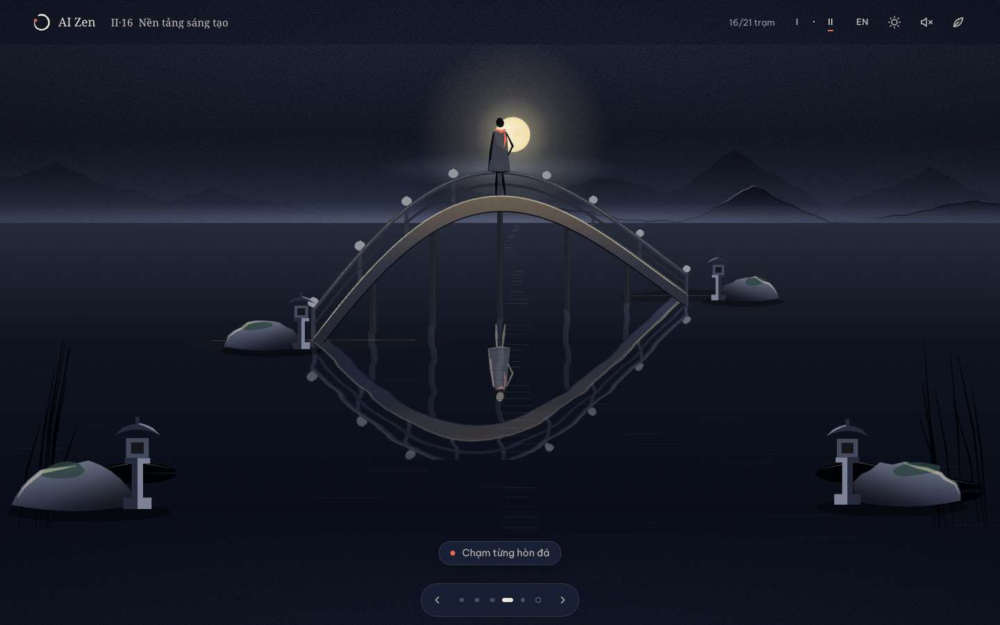
Trạng thái kết: 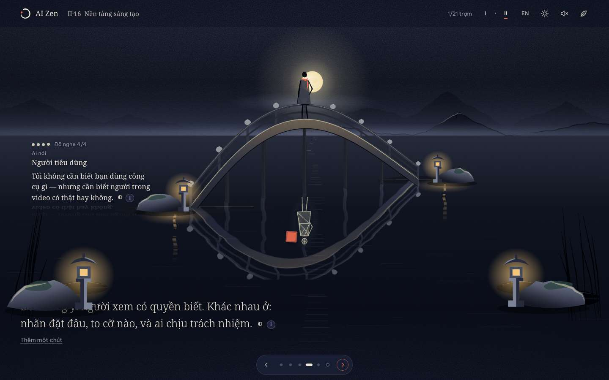
**Hiện tại**
- Thấy: cây cầu cong và bóng nước của nó, một người mẫu quàng khăn son đứng trên đỉnh cầu, trăng phía sau. Có 4 đá đèn quanh bờ (`t34-4-a`).
- Làm:
  - Prompt "Chạm từng hòn đá": đèn thắp và lời của một phía hiện ra.
  - Vuốt trên mặt nước thì bóng lộ ra avatar đa giác (`t34-4-c-swipe`). Cử chỉ này không được nhắc trên màn.
  - Đủ 4 đá: một ấn son rơi xuống cạnh bóng.
- Chữ trên màn:
  - Mỗi đá: "Ai nói · Người mẫu thật · Bộ luật Dân sự: dùng hình ảnh một người phải được họ đồng ý; dùng vì mục đích thương mại phải trả thù lao." · bộ đếm "Đã nghe 1/4".
  - Ba đá còn lại: "Thương hiệu (bên đăng) — Luật AI Việt Nam, từ 01/03/2026: ảnh, video, giọng AI giả lập người thật phải có nhãn dễ nhận biết." · "Người tiêu dùng — Tôi không cần biết bạn dùng công cụ gì — nhưng cần biết người trong video có thật hay không." · "Nền tảng mạng xã hội — YouTube yêu cầu người đăng khai báo nội dung AI trông như thật…".
  - Insight: "Đều đồng ý: người xem có quyền biết. Khác nhau ở: nhãn đặt đâu, to cỡ nào, và ai chịu trách nhiệm."
  - Thêm một chút: "Luật còn yêu cầu thông báo rõ … Đây không phải tư vấn pháp lý."

**Lỗi**
1. [GP] Cử chỉ hay nhất (vuốt nước để thấy avatar giả) không được gợi ý; chỉ có trong aria. Ấn son rơi *cạnh* bóng, không làm thay đổi gì nhìn thấy được.
2. [LO] Insight bị đá và đèn đá ở gần bên trái che chữ đầu ("Đều đồng ý: người…", `t34-4-d-done`). Mỗi lời có bóng chữ phản chiếu đọc không được. Cầu và bóng nước tạo hình con mắt, chưa ra vòng tròn.
3. [CC]
   - Insight dùng câu khuôn "Đều đồng ý… Khác nhau ở…".
   - Ô "Thương hiệu (bên đăng)" lại chứa nội dung luật, không phải ý kiến của thương hiệu.
   - Câu của "Người tiêu dùng" là lời AI Zen tự viết nhưng trình bày như một câu trích dẫn.
4. [LG] Insight nói các bên "khác nhau ở nhãn đặt đâu, to cỡ nào, ai chịu trách nhiệm", nhưng cả 4 lời đều không bàn chuyện đó. Insight không khớp với điều vừa nghe. Hình ảnh chính (bóng giả) không có câu nào nói thẳng ra nó là gì.
5. [Thẩm mỹ] (TM 3) Trăng, sương, cầu cong có khối.
   - Bóng nước và lan can chỉ là nét mảnh, nên cầu và bóng ra hình con mắt chứ không ra vòng tròn.
   - Người mẫu tí hon (≈40×100px).
   - Đá đèn có nét đồ hoạ phẳng, xám lạnh; đèn chưa thắp trông như icon.
   - 40% dưới khung là nước đen trơn.
6. [Cân bằng bố cục] (CB 3)
   - **Lúc mở:** đối xứng qua trục giữa. Cầu và bóng (x 440–1000, y 160–660) ở tâm. Hai đá đèn gần ở hai góc dưới (x 0–250 và 1180–1420). Vùng nước dưới giữa (x 300–1150, y 660–840) trống.
   - **Lúc kết:** lời nói và insight cùng dồn bên trái (x 48–680). Insight bị đá đèn trái đè (`t34-4-d-done`). Nửa phải chỉ còn đá.
7. [Hướng dẫn tương tác] Cử chỉ thật: chạm 4 đá; vuốt mặt nước (cử chỉ ẩn).
   - Đang có: H4 ("Đã nghe n/4" xuất hiện sau đá đầu), H6 (đèn thắp).
   - Đang thiếu: H1 (đá trông như cảnh nền, không thấy là vật chạm được); vuốt nước không có dấu nào (cử chỉ ẩn); H5 (prompt mất sau lần chạm đầu); H7.
   - Lần đầu: em không tự biết phải vuốt nước. HD 2.

**Đề xuất sửa**
- Gameplay: bước 1, prompt "Vuốt mặt hồ" để lộ bóng là avatar đa giác. Bước 2, chạm 4 đá. Khi đủ, ấn son đậu **lên** bóng và viền avatar sáng rõ mà không cần vuốt: nhãn giúp ai cũng thấy cái giả.
- Layout: insight đặt lên vùng nước trống giữa trái. Bỏ bóng chữ phản chiếu.
- Câu chữ viết sẵn:
  - prompt 1 "Vuốt ngón tay trên mặt hồ" · prompt 2 "Chạm từng hòn đá để nghe bốn phía"
  - giải mã "Người trên cầu là thật; bóng dưới nước là người mẫu ảo do AI tạo."
  - Bên đăng: "Theo Luật AI (hiệu lực 01/03/2026), video có người do AI giả lập phải gắn nhãn dễ nhận ra."
  - Người mẫu thật: "Muốn dùng hình tôi phải hỏi tôi; dùng để bán hàng phải trả tiền (Bộ luật Dân sự, Điều 32)."
  - Người xem: "Ví dụ một người xem: “Tôi không cần biết bạn dùng công cụ gì, chỉ cần biết người trong video có thật không.”"
  - Nền tảng: "YouTube buộc người đăng khai báo khi nội dung AI trông như thật."
  - insight "Cả bốn phía cùng đòi một điều: người xem phải biết ai là thật. Gắn nhãn và xin phép trước khi đăng." (21 từ)
  - Thêm một chút: giữ câu hiện tại + "Đây không phải tư vấn pháp lý."
- Thẩm mỹ:
  - Bóng dưới nước vẽ bằng một loại mực khác: avatar đa giác có mặt sáng, mặt tối, không chỉ có nét.
  - Cầu và bóng khép thành một vòng tròn đúng (giảm độ vồng, kéo dài bóng).
  - Người mẫu to gấp 1,6 lần, khăn son bay.
  - Đá đèn thành đèn đá thật có rêu, thắp lên thì có vầng ấm trên nước. Mặt nước có gợn bạc và vệt trăng.
- Bố cục:
  - Giữ vòng cầu ở trục giữa làm hero.
  - Một đá đèn gần chuyển lên 1/3 dưới-phải, to hơn, làm đối trọng; đá còn lại lùi xa.
  - Lời của mỗi đá hiện trên nước ngay dưới đá đó. Insight đặt ở vùng nước trống dưới giữa (x 360–1080, y 700–790).
- Hướng dẫn:
  - Bước 1: dưới bóng có vòng gợn son thở và một mũi tên cong mực mờ chỉ cử chỉ vuốt.
  - Bước 2: bốn đèn chưa thắp mang chấm son (H1). "Đã nghe 0/4" hiện ngay từ đầu (H4).
  - Prompt: "Vuốt ngón tay qua bóng dưới hồ" → "Chạm từng ngọn đèn đá để nghe bốn phía" → "Còn {n} phía".
  - Đứng yên 6 s: đèn kế tiếp nhấp nháy ấm.
  - Vùng chạm đá đã ≥ 44px.

### 34-Quiz · Câu hỏi nhỏ   ·   Mức: Sửa nhẹ   ·   Ưu tiên: P3
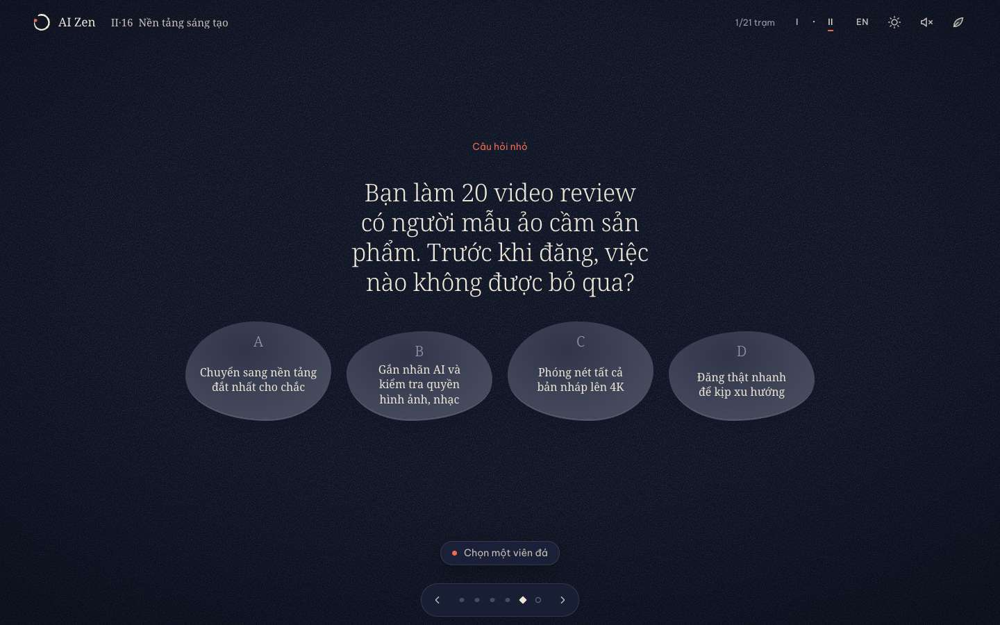
**Hiện tại**
- Thấy: câu hỏi và 4 viên đá A–D. Prompt "Chọn một viên đá".
- Chữ: "Bạn làm 20 video review có người mẫu ảo cầm sản phẩm. Trước khi đăng, việc nào không được bỏ qua?"
  - A "Chuyển sang nền tảng đắt nhất cho chắc"
  - B "Gắn nhãn AI và kiểm tra quyền hình ảnh, nhạc" (đúng)
  - C "Phóng nét tất cả bản nháp lên 4K"
  - D "Đăng thật nhanh để kịp xu hướng"
  - Giải thích: "Luật Trí tuệ nhân tạo Việt Nam yêu cầu gắn nhãn dễ nhận biết khi AI giả lập người thật; dùng hình người thật thì cần họ đồng ý."

**Lỗi**
1. [GP] Ba đáp án nhiễu là bù nhìn, ai cũng loại được. Cả 3 trạm của vườn đều có đáp án là B (`sheet-quiz.jpg`).
2. [LO] ổn.
3. [CC] "nhạc" chỉ có trong thẻ checklist, không có trên slide nào.
4. [LG] Quiz chỉ kiểm slide 2 và 4, không kiểm chọn nền tảng và credit.
5. [Thẩm mỹ] (TM 2, em tự chấm; calibration không chấm quiz) 4 viên đá xám bo tròn chứa chữ, xếp hàng ngang trên nền đen trơn, đúng kiểu "đá-nút" (a). Không có cảnh.
6. [Cân bằng bố cục] (CB 3) Câu hỏi và hàng đá ở giữa trên (y≈200–600). 1/3 dưới trống tới prompt. Đối xứng nhưng tĩnh.
7. [Hướng dẫn tương tác] ổn (HD 4): prompt "Chọn một viên đá" đúng vật, và 4 đá rõ ràng là chỗ chạm.

**Đề xuất sửa**
- Gameplay: đổi vị trí đáp án đúng, viết đáp án nhiễu hợp lý. Có thể thêm một câu về credit.
- Câu chữ viết sẵn:
  - A "Chỉ cần gắn nhãn AI là đủ"
  - B "Người mẫu ảo nên không cần xin phép ai"
  - C "Gắn nhãn AI, kiểm tra quyền hình ảnh và giấy phép nhạc" (đúng)
  - D "Phóng nét cả 20 bản lên 4K cho chuyên nghiệp"
  - Giải thích "Nhãn AI là bắt buộc khi giả lập người; nhưng hình người thật và nhạc vẫn cần giấy phép riêng."
- Thẩm mỹ: đặt 4 viên đá cuội thật, chữ khắc, lên mặt nước tối có bóng trăng và sương mỏng; hoặc dùng lại khung cảnh của slide cuối trạm làm nền.
- Bố cục: đá xếp theo đường cong nhẹ. Câu hỏi lên 1/4 trên. Lời giải thích hiện trên mặt nước dưới viên đã chọn.
- Hướng dẫn: giữ như hiện tại; thêm vầng thở trên các đá khi đứng yên 6 s.

### 34-Ensō · Tóm lại trong 1 câu   ·   Mức: Sửa nhẹ   ·   Ưu tiên: P2

**Hiện tại**
- Thấy: vòng ensō, câu tóm tắt, nút "Trạm sau: Skills, quy trình & workflow".
- Chữ: "Chọn đúng cây đục cho đúng nhát — và luôn biết mình đang tiêu bao nhiêu nước trong bình."

**Lỗi**
1. [GP] ổn.
2. [LO] ổn.
3. [CC] Câu chỉ dùng ẩn dụ. "Cây đục, nhát" không xuất hiện ở slide nào.
4. [LG] Bỏ mất ý quyền/nhãn, tức nửa trạm.
5. [Thẩm mỹ] ổn (TM 4): nét ensō có vệt cọ khô, có ấn son, nền đêm sạch.
6. [Cân bằng bố cục] ổn (CB 4): vòng ensō ở tâm, chữ nằm trong lòng vòng, hai nút ngay dưới.
7. [Hướng dẫn tương tác] ổn (HD 4): hai nút "Trạm sau…", "Về bản đồ" rõ, đủ lớn.

**Đề xuất sửa**
- Câu chữ viết sẵn: "Chọn nền tảng theo việc, nháp rẻ trước khi tốn credit, và gắn nhãn AI, xin phép trước khi đăng."
- Thẩm mỹ: giữ.
- Bố cục: giữ.
- Hướng dẫn: giữ.

---

## Trạm 35 · Skills, quy trình & workflow (II·17)
**Mục tiêu học (1 câu):** Biến một việc lặp lại thành skill hoặc quy trình ở mức tự động vừa đủ, và giữ người duyệt ở những chỗ quan trọng.

**Mạch hiện tại:** 1 Bậc thang tự động hoá → 2 Mở một cuộn skill → 3 Từ thói quen thành chuẩn → 4 Spec trước, code sau → 5 Dây chuyền trong xưởng → quiz → ensō.

**Vấn đề mạch:**
- Slide 1 tung ra 5 thuật ngữ (Prompt, Skill, Agent, Workflow, Hook) cùng lúc, trước khi người xem thấy một skill cụ thể. Mạch đi từ khó xuống dễ.
- Slide 3 là lịch sử các mốc (MCP, Spec Kit…), chen giữa hai slide thực hành.
- Slide 4 là quy trình làm phần mềm bằng agent code, tức **sai trạm** (thuộc t36) và trùng với 36-1, 36-3.
- Thẻ "Mẫu SKILL.md trống" và "Checklist biến một việc lặp lại thành skill" có trong `takeaways` nhưng không slide nào đưa ra.

**Mạch đề xuất:** 1 Mở một cuộn skill (chuyện cụ thể: caption, báo cáo tuần; thẻ "Mẫu SKILL.md trống") → 2 Viết skill từ một lần làm tốt (thay slide Spec; thẻ "Prompt nhờ AI viết skill…" + checklist) → 3 Bậc thang: chọn mức vừa đủ → 4 Dây chuyền có người duyệt → (mang skill sang công cụ khác: slide ngắn hoặc cắt) → quiz → ensō.

**Kicker / tóm tắt / thẻ mang về hiện tại:**
- Kicker: "Thợ giỏi không nhớ mọi thứ — họ treo dụng cụ đúng chỗ." → **lỗi:** ổn, khớp với vách treo cuộn ở slide 2.
- Tóm tắt: "Đừng nhắc AI mỗi ngày — dạy nó một lần, treo đúng chỗ, gọi khi cần." → **lỗi:** thiếu ý người duyệt (slide 5). → **đề xuất:** "Dạy AI một lần bằng skill, chỉ tự động tới mức vừa đủ, và giữ cho mình những chỗ cần duyệt."
- Thẻ mang về: 3 thẻ. Chỉ "Prompt nhờ AI viết skill từ một lần làm thành công" có trong slide, lại treo trên một cái móc nhỏ không ai gợi ý (`t35-4-d-done`). → **đề xuất:** đưa đủ 3 thẻ vào đúng slide như mạch đề xuất.

Điểm: Gameplay 4/10 · Layout 6/10 · Câu chữ 5/10 · Logic thông tin 4/10 · Thẩm mỹ 5/10 · Cân bằng 5/10 · Hướng dẫn 5/10

### 35-1 · Bậc thang tự động hoá   ·   Mức: Làm lại   ·   Ưu tiên: P1 (dạy sai thứ tự, dạy sai về hook)
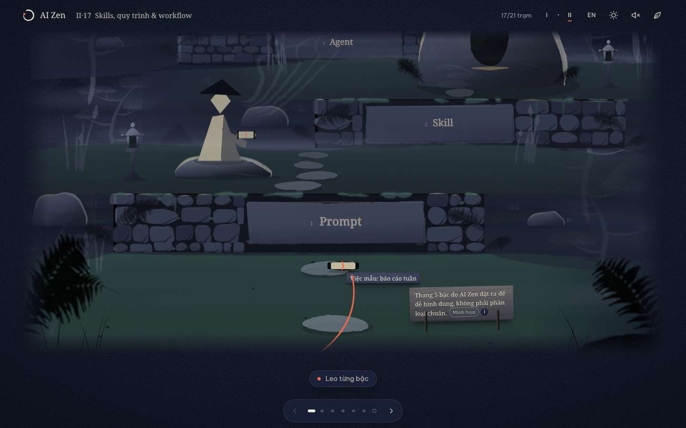
Trạng thái kết: 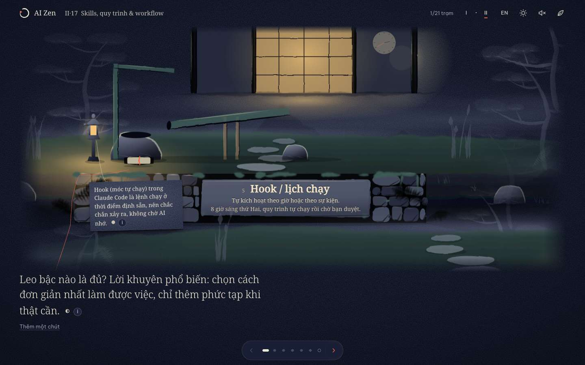
**Hiện tại**
- Thấy: các thềm đá rêu leo dốc. Mỗi thềm có một tấm đá chữ nhật ghi tên bậc. Cuộn "báo cáo tuần" có sợi chỉ son kéo ra mép dưới (`t35-1-a`).
- Làm: prompt "Leo từng bậc". Vuốt lên, cuộn chuột hoặc chạm bậc: camera cẩu lên, đèn bậc thắp, tiểu cảnh chạy. Xem đủ 5 bậc thì insight hiện ra. Không có lựa chọn nào.
- Chữ trên màn (DOM, theo bậc):
  - "1 Prompt · Nói một lần, xong là quên. Lần sau lại dặn từ đầu. · Thứ Hai nào cũng gõ: “tóm tắt số liệu tuần này theo mẫu…”"
  - "2 Skill · Bản hướng dẫn đóng gói; AI tự mở khi gặp việc hợp."
  - "3 Agent · Tự làm nhiều bước, tự chọn công cụ. · Mở bảng tính, tính chênh lệch, viết bản nháp."
  - "4 Workflow · Nhiều bước nối nhau theo lối vạch sẵn, có chốt kiểm tra. · Lấy số → agent viết → bạn duyệt → gửi." + fact "Anthropic phân biệt: workflow đi theo lối vạch sẵn bằng code; agent tự quyết bước đi và công cụ."
  - "5 Hook / lịch chạy · Tự kích hoạt theo giờ hoặc theo sự kiện. · 8 giờ sáng thứ Hai, quy trình tự chạy rồi chờ bạn duyệt." + fact "Hook (móc tự chạy) trong Claude Code là lệnh chạy ở thời điểm định sẵn, nên chắc chắn xảy ra, không chờ AI nhớ."
  - Biển chân thang: "Thang 5 bậc do AI Zen đặt ra để dễ hình dung, không phải phân loại chuẩn."
  - Insight: "Leo bậc nào là đủ? Lời khuyên phổ biến: chọn cách đơn giản nhất làm được việc, chỉ thêm phức tạp khi thật cần."
  - Thêm một chút: "Bậc cao tiện hơn nhưng khó soát hơn…"

**Lỗi**
1. [GP] Thao tác thực chất là bấm "tiếp" 5 lần, không có quyết định nào. Sợi chỉ son mảnh dần (ý "càng cao càng ít chạm vào việc") không nhìn ra. Người giấy của bậc Agent đã đứng trên màn ngay từ bậc 1 (`t35-1-b-prompt`).
2. [LO] Tấm đá chữ nhật có chữ trông như thẻ UI. Fact của bậc Hook che mép thềm (`t35-1-d-hook`).
3. [CC]
   - Câu thiếu chủ ngữ: "Tự làm nhiều bước" (ai làm?).
   - Fact Hook nói "thời điểm định sẵn", đặt cạnh ví dụ "8 giờ sáng thứ Hai", nên người đọc hiểu hook là hẹn giờ. Thực tế hook trong Claude Code chạy theo sự kiện trong lúc AI làm việc (vd. trước khi dùng một công cụ), không theo giờ.
   - Insight mở bằng câu hỏi mà người xem chưa hề phải trả lời.
4. [LG]
   - **Mâu thuẫn ngay trong slide:** fact Anthropic nói workflow là "lối vạch sẵn", còn agent "tự quyết". Theo chính nguồn đó, workflow dễ đoán và đơn giản hơn agent, vậy mà thang đặt Workflow **cao hơn** Agent.
   - Hook/lịch chạy là chuyện *khi nào bắt đầu*, không phải một nấc "tự động hơn" agent.
   - Insight không khớp với hành động: người xem leo hết 5 bậc chứ không chọn bậc nào là đủ.
5. [Thẩm mỹ] (TM 2) Tường đá khan, rêu, dương xỉ làm nền được. Nhưng:
   - Mỗi thềm gắn một phiến chữ nhật xám phẳng ghi "Prompt/Skill/Agent" như panel UI (calibration).
   - Người giấy là khối tam giác be phẳng.
   - Cả cảnh phủ một lớp xanh xám đều, không có nguồn sáng chính; sương là dải mờ đều.
6. [Cân bằng bố cục] (CB 2)
   - **Lúc mở:** thềm đá đi zig-zag, nhưng các phiến chữ lại thẳng hàng trên trục giữa (x 520–900). Nửa phải dưới (x 900–1380, y 450–720) trống. Biển "Thang 5 bậc…" chen với nhãn "Việc mẫu" ở giữa-phải dưới.
   - **Lúc kết:** fact card ở trái giữa, insight dưới trái, phải trống (`t35-1-d-hook`).
7. [Hướng dẫn tương tác] Cử chỉ thật: vuốt hoặc kéo lên, cuộn chuột, hoặc chạm bậc.
   - Đang có: H4 tạm (số 1–5 trên phiến), H6 (đèn bậc thắp).
   - Đang thiếu: H1 (cuộn "báo cáo tuần" không có chấm son, dù art direction nói người xem kéo cuộn); H2 (không có mũi tên hay rãnh chỉ hướng lên).
   - H5: "Leo từng bậc" không nói vật và cử chỉ, lại mất sau lần chạm đầu.
   - Nút bậc chỉ cao 15–27px (DOM "Bậc 5 116x15", "Bậc 1 109x27"); ấn son 19×19 — đều dưới 44px.
   - Lần đầu: em vuốt lên được là nhờ thử mò. HD 2.

**Đề xuất sửa**
- Gameplay (concept mới, **xếp việc vào bậc vừa đủ**): giữ tranh thềm đá; trên bãi có 3 cuộn việc. Người xem kéo mỗi cuộn lên một thềm.
  - Thấp quá: sương cuốn lời dặn đi ("tuần sau lại phải dặn").
  - Cao quá: sợi chỉ son đứt ("việc chạy mà không ai soát").
  - Vừa: đèn thềm thắp.
  - Thứ tự thềm: Prompt → Skill → Workflow → Agent. "Lịch / hook" là ống tre shishi-odoshi đặt bên cạnh, gắn được vào bất kỳ thềm nào ("tự bắt đầu").
- Layout: tên bậc khắc thẳng vào mặt đá, bỏ tấm chữ nhật. Người giấy chỉ hiện ở thềm Agent.
- Câu chữ viết sẵn:
  - prompt "Kéo mỗi cuộn việc lên bậc thấp nhất làm được"
  - cuộn việc "Viết 1 caption cho bài hôm nay" · "Báo cáo tuần, thứ Hai nào cũng cùng một mẫu" · "Lấy số, viết bản nháp, chờ bạn duyệt rồi gửi"
  - bậc "Prompt — bạn dặn một lần trong khung chat" · "Skill — lời dặn được đóng gói; AI tự mở khi gặp việc hợp" · "Workflow — các bước vạch sẵn, chạy đúng thứ tự, có chốt duyệt" · "Agent — AI tự chọn bước và công cụ" · ống tre "Lịch / hook — tự bắt đầu theo giờ hoặc khi có sự kiện"
  - thấp quá "Bậc này quên ngay sau buổi chat — tuần sau bạn lại dặn từ đầu."
  - cao quá "Việc đơn giản mà để AI tự quyết hết — khó soát, sai cũng không ai thấy."
  - fact Hook "Trong Claude Code, hook là lệnh tự chạy ở một bước cố định khi AI làm việc (vd. trước khi sửa file), nên chắc chắn xảy ra, không chờ AI nhớ." (cần kiểm nguồn ví dụ)
  - insight "Chọn bậc thấp nhất làm được việc. Leo cao hơn thì tiện hơn, nhưng bạn càng ít thấy AI đang làm gì." (21 từ)
  - Thêm một chút "Thang này do AI Zen đặt ra để dễ hình dung. Anthropic cũng khuyên bắt đầu từ cách đơn giản nhất, chỉ thêm bước khi thật cần."
- Thẩm mỹ:
  - Bỏ phiến chữ. Khắc tên bậc vào mặt đứng của tường đá, chữ mực bạc theo phối cảnh, bắt viền trăng.
  - Mỗi thềm có một đèn đá ấm thắp dần, tạo bậc sáng-tối rõ.
  - Người giấy là origami có nếp gấp sáng tối và bóng. Học ánh sáng 26-1: trăng sau lưng, viền sáng trên mép đá.
- Bố cục:
  - Tên khắc lệch theo zig-zag của từng thềm, không cùng một trục.
  - 3 cuộn việc (concept mới) đặt ở chân thang, 1/3 dưới-trái. Biển tỉ lệ thu thành cọc nhỏ ở chân thang bên trái.
  - Insight lên bầu trời trên-phải khi tới đỉnh.
- Hướng dẫn:
  - Cuộn việc mang chấm son, sợi chỉ son làm tay cầm (H1).
  - Khi nhấc cuộn, mép các thềm hiện vạch sáng mờ làm đích thả (H3). Ở chân thang, mép phải có mũi tên mực mờ chỉ lên (H2).
  - Bộ đếm "0/3 việc đã xếp" (H4).
  - Prompt: "Kéo cuộn ‘Viết 1 caption’ lên một bậc" → "Bậc thấp nhất làm được là bậc nào?" → "Còn 2 cuộn".
  - Đứng yên 6 s: cuộn nhích lên 10px rồi rơi về.
  - Vùng chạm bậc ≥ 44px.

### 35-2 · Mở một cuộn skill   ·   Mức: Sửa nhẹ   ·   Ưu tiên: P2
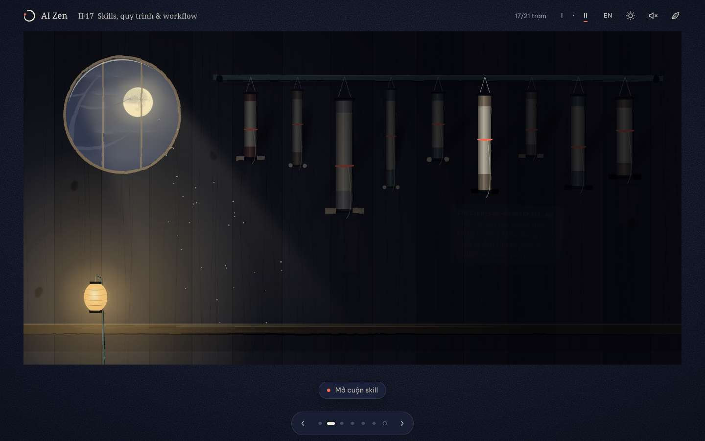
Trạng thái kết: 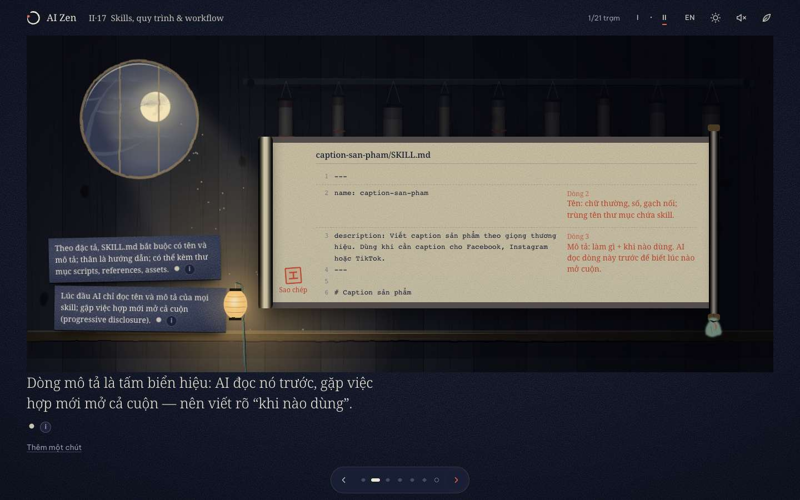
**Hiện tại**
- Thấy: vách gỗ tối với 9 cuộn treo, cửa sổ tròn có trăng, một đèn tay ở góc dưới trái (`t35-2-a`).
- Làm:
  - Prompt "Mở cuộn skill". Đèn đi theo chuột (trên phone thì kéo).
  - Soi trúng thẻ đọc được thì hiện tên + mô tả và một fact. Chạm cuộn đó thì nó mở ngang ra SKILL.md, lề có ghi chú son.
  - Chạm cuộn khác thì không có gì xảy ra.
- Chữ trên màn:
  - Thẻ: "caption-san-pham/SKILL.md · Viết caption sản phẩm theo giọng thương hiệu. Dùng khi cần caption cho Facebook, Instagram hoặc TikTok."
  - Fact: "Lúc đầu AI chỉ đọc tên và mô tả của mọi skill; gặp việc hợp mới mở cả cuộn (progressive disclosure)." · "Theo đặc tả, SKILL.md bắt buộc có tên và mô tả; thân là hướng dẫn; có thể kèm thư mục scripts, references, assets."
  - Ghi chú lề: "Tên: chữ thường, số, gạch nối; trùng tên thư mục chứa skill." · "Mô tả: làm gì + khi nào dùng. AI đọc dòng này trước…" · …
  - Insight: "Dòng mô tả là tấm biển hiệu: AI đọc nó trước, gặp việc hợp mới mở cả cuộn — nên viết rõ “khi nào dùng”."
  - Thêm một chút: "Đặc tả khuyên giữ SKILL.md dưới 500 dòng…"

**Lỗi**
1. [GP] Người xem là người *đi tìm* cuộn, trong khi điều cần dạy là *AI* tìm cuộn bằng dòng mô tả. Ý "AI đọc mô tả trước" chỉ được nói, không được thấy. Chạm cuộn khác là dead click.
2. [LO] Khi cuộn mở, góc trái dồn cùng lúc 2 fact, đèn, insight và dấu sao chép. Trong cuộn chỉ thấy 6 dòng đầu (`t35-2-c-open`).
3. [CC]
   - Tiếng Anh sót: "(progressive disclosure)"; "scripts, references, assets"; túi vải ghi "references/".
   - "đặc tả" là từ kỹ thuật, chưa giải thích.
   - Prompt "Mở cuộn skill" không nói cuộn nào, cũng không nói phải soi đèn trước.
4. [LG] Mạch đúng thứ tự (thấy thẻ → mở → hiểu), nhưng insight là câu khẳng định chứ không phải điều người xem vừa chứng kiến.
5. [Thẩm mỹ] (TM 4) Vách gỗ, cửa tròn có trăng, cột sáng có bụi, đèn tay ấm — đẹp. Nhưng:
   - 9 cuộn là ống trụ mảnh gần giống nhau, không ra cuộn giấy có trục và tua. Thẻ là chữ nhật trắng.
   - Vũng sáng đèn tay yếu, không đổ bóng cuộn.
   - Nửa dưới vách tối trơn.
6. [Cân bằng bố cục] (CB 3)
   - **Lúc mở:** cuộn dồn vào một dải ngang phía trên (x 440–1350, y 150–440). Cửa tròn ở trên-trái, đèn tay ở góc dưới trái (x 170–240, y 560–740). Vùng giữa-dưới (x 300–1390, y 450–660) trống, khoảng 40% khung.
   - **Lúc kết:** cuộn mở chiếm giữa-phải, nhưng 2 fact, đèn và insight dồn hết vào cột trái (x 48–420) (`t35-2-c-open`).
7. [Hướng dẫn tương tác] Cử chỉ thật: rê hoặc kéo đèn dọc vách, rồi chạm cuộn đọc được.
   - Đang có: đèn đi theo chuột nên trên desktop tự lộ ra; thẻ hiện khi soi tới (H6).
   - Đang thiếu: H1 (đèn không có chấm son; trên phone phải kéo mà không có dấu nào); H2 (không có rãnh dọc vách).
   - H5: "Mở cuộn skill" là bước 2, bỏ qua bước 1 (soi đèn).
   - Chạm cuộn khác không có phản hồi gì. HD 3.

**Đề xuất sửa**
- Gameplay: ra đề trước, "Việc hôm nay: viết caption cho áo linen". Đèn là AI: tự quét dọc các thẻ. Người xem chọn mô tả cho cuộn caption:
  - "Caption" (mơ hồ): đèn lướt qua, không dừng, AI trả lời chung chung.
  - "Viết caption sản phẩm… Dùng khi cần caption Facebook/TikTok": đèn dừng, cuộn tự mở.
- Layout: fact đặt dưới cuộn, chỉ hiện một fact mỗi lần. Cuộn mở cao hơn để thấy tới mục "Ví dụ".
- Câu chữ viết sẵn:
  - prompt 1 "Chọn dòng mô tả cho cuộn caption" · prompt 2 "Chạm cuộn để đọc bên trong"
  - fact "Lúc đầu AI chỉ đọc tên và mô tả của mọi skill; gặp việc hợp mới mở cả cuộn."
  - fact "Mỗi SKILL.md bắt buộc có tên và mô tả; phần thân là các bước; có thể kèm túi tài liệu, mẫu, công cụ."
  - insight "AI chỉ đọc dòng mô tả để chọn cuộn. Mô tả mơ hồ thì cuộn đúng vẫn bị bỏ qua." (18 từ)
  - Thêm một chút "Nên giữ SKILL.md dưới 500 dòng; tài liệu dài để trong túi file kèm. Mỗi công cụ AI hỗ trợ skill ở mức khác nhau."
- Thẩm mỹ:
  - Cuộn vẽ thành makimono thật: trục gỗ có núm tiện, lụa bọc có hoa văn, dây buộc, thẻ giấy xé mép treo dây. Độ dài và màu lụa khác nhau.
  - Đèn tay đổ vũng ấm hình nón lên vách; bóng cuộn đổ chéo, xa dần đèn. Sàn gỗ có ánh.
- Bố cục:
  - Giá cuộn hạ xuống giữa khung (y 260–560). Cửa tròn giữ trên-trái làm đối trọng. Đèn tay ở dưới giữa, trên rãnh.
  - Khi mở cuộn: fact đặt ngay dưới cuộn (y 600–660), insight lên vách trên-phải.
- Hướng dẫn:
  - Cán đèn tay mang chấm son (H1). Dưới giá có rãnh gỗ ngang mờ với 9 khấc ứng 9 cuộn (H2). Thẻ đọc được thở sáng khi đèn tới gần (H3).
  - Prompt: "Kéo đèn dọc giá để soi thẻ tên" → (khi soi trúng) "Chạm cuộn này để mở" → (concept mới) "Chọn dòng mô tả cho cuộn".
  - Đứng yên 6 s: đèn trôi 20px về phía cuộn đọc được.
  - Chạm cuộn khác: tua đung đưa, kèm chữ "Thẻ này chưa đọc được — soi cuộn khác".

### 35-3 · Từ thói quen thành chuẩn   ·   Mức: Làm lại   ·   Ưu tiên: P2
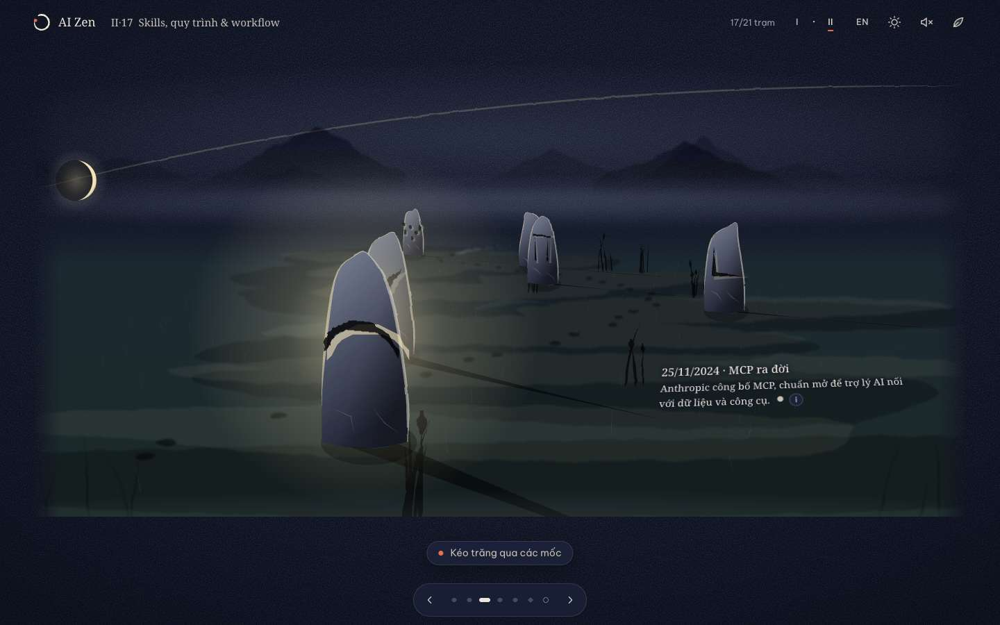
Trạng thái kết: 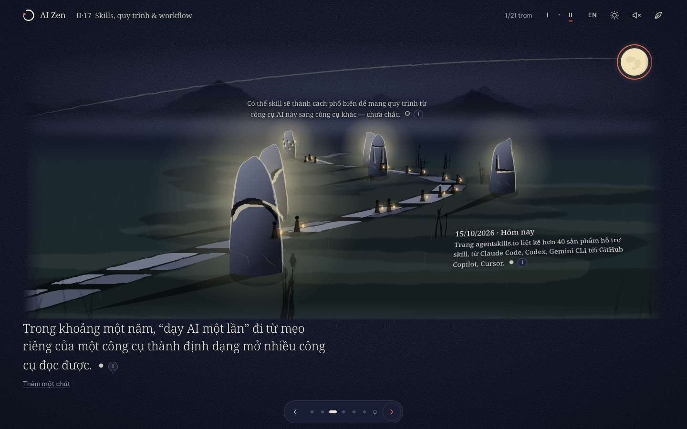
**Hiện tại**
- Thấy: đồng rêu dưới trăng, các cột đá, lối mòn đi vào sương. Trăng lưỡi liềm nằm bên trái (`t35-3-a`).
- Làm: prompt "Kéo trăng qua các mốc". Kéo trăng theo cung: trăng tròn dần, cột sáng lên, lối được lát. Tới "Hôm nay" có nhiều người cầm đèn đi trên lối.
- Chữ trên màn:
  - Mốc: "25/11/2024 · MCP ra đời — Anthropic công bố MCP, chuẩn mở để trợ lý AI nối với dữ liệu và công cụ." · "Workflow hay agent — …khuyên bắt đầu từ cách đơn giản." · "Spec trước, code sau — GitHub mở mã Spec Kit…" · "16/10/2025 · Skills ra mắt — …Claude chỉ nạp khi việc cần tới." · "Thành chuẩn mở — …agentskills.io…" · "15/10/2026 · Hôm nay — Trang agentskills.io liệt kê hơn 40 sản phẩm hỗ trợ skill…"
  - Dự báo: "Có thể skill sẽ thành cách phổ biến để mang quy trình từ công cụ AI này sang công cụ khác — chưa chắc."
  - Insight: "Trong khoảng một năm, “dạy AI một lần” đi từ mẹo riêng của một công cụ thành định dạng mở nhiều công cụ đọc được."

**Lỗi**
1. [GP] Một thanh trượt để đọc 6 fact, không có "aha". Fact luôn hiện ở cùng một chỗ bên phải, không gắn với cột nào.
2. [LO] Hình mực trên cột (cầu, lối rẽ, thước…) không đọc ra được (`t35-3-b-mid`).
3. [CC]
   - Thuật ngữ chưa giải thích: "MCP", "Spec Kit", "nạp", "định dạng mở".
   - Dự báo đặt "chưa chắc" ở cuối câu, nên người đọc đọc như một khẳng định rồi mới gặp chữ "chưa chắc".
   - Insight dài 25 từ, đúng mức trần.
4. [LG]
   - Hai mốc MCP và "workflow hay agent" không thuộc câu chuyện "dạy AI một lần".
   - Mốc "Spec trước, code sau" xuất hiện trước slide 4, nơi spec mới được giải thích.
   - Hệ quả thực tế cho người xem (skill mang được sang công cụ khác) chỉ nằm trong câu dự báo nhỏ.
5. [Thẩm mỹ] (TM 2)
   - Đồng rêu xanh xám phẳng, có viền mờ hình chữ nhật.
   - Các cột đá xám đứng như thẻ; hình mực trên cột không đọc ra.
   - Trăng lưỡi liềm và cung trời chỉ là nét mảnh; sương là dải đều.
   - Không có hero (calibration (b)).
6. [Cân bằng bố cục] (CB 2)
   - **Lúc mở:** chỉ có một cột lớn ở trái giữa (x 460–600, y 360–640). Bốn cột nhỏ dồn một hàng ở giữa (y 300–450). 1/3 trên là trời trống. Fact ở giữa-phải (x 950–1300, y 520–590). Góc dưới phải trống.
   - **Lúc kết:** 3 khối chữ rời (dự báo trên giữa, fact phải, insight dưới trái), mắt phải đi zig-zag (`t35-3-c-today`).
7. [Hướng dẫn tương tác] Cử chỉ thật: kéo trăng theo cung.
   - Đang có: trăng to 92px; cung vẽ sẵn (H2 tạm); vòng son quanh trăng khi kéo (H6); prompt đúng vật, đúng cử chỉ (H5).
   - Đang thiếu: vạch mốc trên cung (6 mốc không đánh dấu, nên không biết còn bao xa); chấm son trên trăng lúc mở (H1); "mốc n/6" (H4).
   - Lần đầu: em kéo được ngay. HD 4.

**Đề xuất sửa**
- Gameplay (concept mới, **mang cuộn sang xưởng khác**): trên vách có 4 giá ghi tên công cụ (danh sách lấy từ agentskills.io, cần kiểm nguồn từng tên). Người xem kéo cuộn "caption-san-pham" từ giá này sang giá khác: ở giá nào cuộn cũng mở ra cùng một nội dung. Các mốc ngày rút thành 2 chú thích nhỏ dưới giá. Thiếu thời gian thì cắt slide này.
- Layout: một giá, một câu.
- Câu chữ viết sẵn:
  - prompt "Kéo cuộn skill sang giá của công cụ khác"
  - insight "Cùng một cuộn skill mở được ở nhiều công cụ AI: dạy một lần, mang theo được, không bị khoá vào một app." (21 từ)
  - Thêm một chút "Skill thành chuẩn mở ngày 18/12/2025; trang agentskills.io (trang của chính chuẩn) liệt kê hơn 40 sản phẩm hỗ trợ. Mức hỗ trợ ở mỗi nơi khác nhau."
- Thẩm mỹ:
  - Concept mới: vách có nhiều giá gỗ như 35-2, mỗi giá một đèn và một bảng tên khắc.
  - Nếu giữ cảnh: đồng rêu có sắc độ theo xa gần, lối lát đá có khối, cột đá có hình khắc rõ (cầu, cuộn…) bắt viền trăng.
- Bố cục:
  - Lối đi từ góc dưới trái lên 1/3 phải. Cột mốc xếp dọc lối theo xa gần.
  - Fact viết trên rêu ngay chân cột tương ứng. Insight lên vùng trời trống trên-phải.
- Hướng dẫn:
  - Cung trời có 6 khấc nhỏ kèm năm viết tắt (H2). Trăng mang chấm son lúc mở (H1). Dưới trăng ghi "Mốc 1/6" (H4).
  - Giữ prompt "Kéo trăng qua các mốc"; sau mốc 3 đổi thành "Còn 3 mốc nữa".
  - Đứng yên 6 s: trăng nhích dọc cung 10px.

### 35-4 · Spec trước, code sau   ·   Mức: Làm lại   ·   Ưu tiên: P2 (sai trạm, kết thúc hụt)
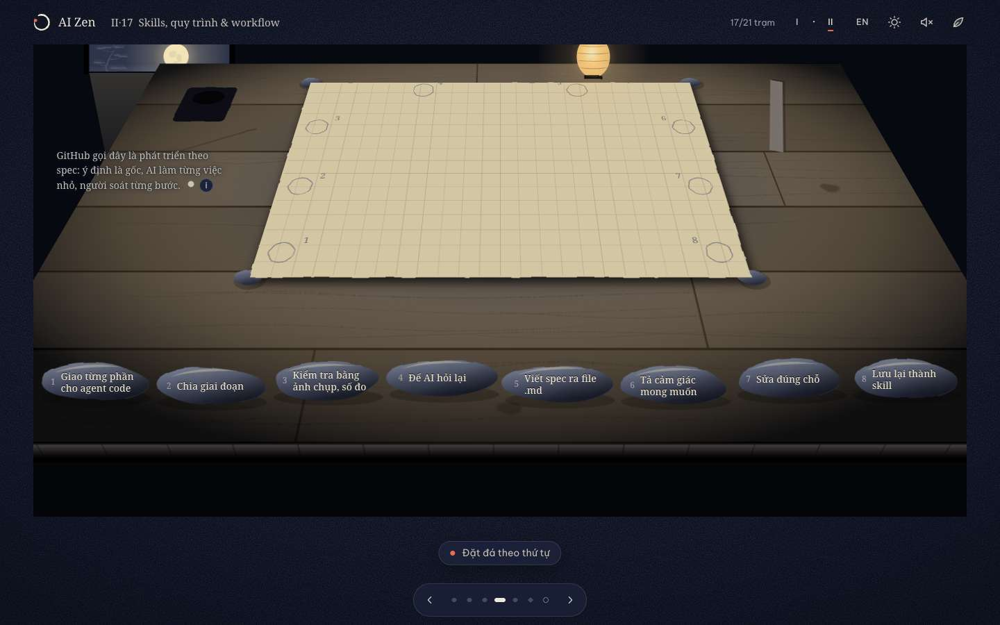
Trạng thái kết: 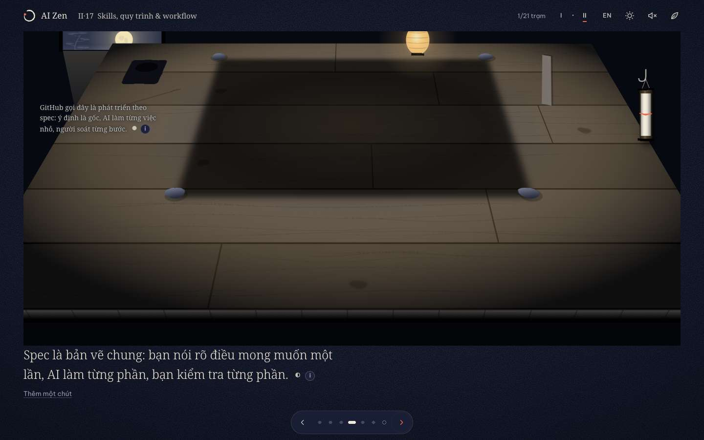
**Hiện tại**
- Thấy: bàn thợ nhìn từ trên xuống, tờ bản vẽ có 8 vòng đánh số, mép bàn có 8 viên sỏi đánh số. Góc trên trái có fact GitHub (`t35-4-a`).
- Làm:
  - Prompt "Đặt đá theo thứ tự". Chạm sỏi: đúng thì tờ giấy đổi dần (phác → dấu hỏi → khối spec → cắt ô → nhà giấy pop-up dựng lên, `t35-4-e-popup`).
  - Viên 8: tờ giấy cuộn lại, treo lên một cái móc nhỏ ở mép phải. Trên bàn còn lại một mảng tối hình thang.
  - Thẻ mang về nằm trong cuộn trên móc, không có gợi ý nào bảo chạm vào đó.
- Chữ trên màn:
  - Đá: "1 Giao từng phần cho agent code · 2 Chia giai đoạn · … · 6 Tả cảm giác mong muốn · 7 Sửa đúng chỗ · 8 Lưu lại thành skill".
  - Khi đúng: "4. Chia giai đoạn — Cắt thành việc nhỏ, mỗi việc tự kiểm tra được."
  - Fact: "GitHub gọi đây là phát triển theo spec: ý định là gốc, AI làm từng việc nhỏ, người soát từng bước."
  - Insight: "Spec là bản vẽ chung: bạn nói rõ điều mong muốn một lần, AI làm từng phần, bạn kiểm tra từng phần."
  - Thêm một chút: "Tên công cụ chỉ là ví dụ…"

**Lỗi**
1. [GP] Lại là quiz xếp đá với số phím tắt gây hiểu nhầm (đá "8 Lưu lại thành skill" tình cờ trùng số đúng). Thứ tự thẳng hàng không thể hiện được vòng "kiểm tra → sửa → kiểm tra lại".
2. [LO]
   - Kết thúc hụt: bàn trống tối, mảng hình thang thực ra là bóng của tờ giấy (`t35p-sheet-sh`) còn sót lại (`t35-4-d-done`).
   - Cuộn có thẻ nhỏ xíu ở mép phải.
   - Dòng ghi chú bị đèn treo che chữ (`t35-4-c-mid`). Đá đã đặt teo thành sỏi đen, mất nhãn.
   - Phone: fact xám trên nền gỗ xám, khó đọc (`t35-4-p`).
3. [CC]
   - "spec", "file .md", "agent code" không được giải thích bằng lời thường.
   - "ý định là gốc" là văn dịch máy (từ "intent as the source of truth").
   - Insight chỉ giải nghĩa spec bằng ẩn dụ "bản vẽ chung".
4. [LG] **Sai trạm và trùng ý:** đây là quy trình làm phần mềm bằng agent code, thuộc t36 (36-1 dạy viết spec, 36-3 dạy làm từng phần). Trạm 35 nói về skill và workflow, nhưng slide này không giúp người xem biến một việc của họ thành skill. Mục v1 nói "thẻ không hiện" là chưa đúng: thẻ nằm trên móc, chỉ là không ai gợi ý chạm vào.
5. [Thẩm mỹ] (TM 3) Bàn ván, đèn treo, nghiên — ổn. Nhưng:
   - Tờ giấy là chữ nhật be phẳng có lưới; các vòng đánh số trông như ô UI.
   - 8 viên sỏi là đá-nút xếp hàng (calibration (a)).
   - Khoảnh khắc đẹp duy nhất là nhà giấy pop-up ở bước 5, có bóng (`t35-4-e-popup`).
   - Kết thúc để lại một mảng tối hình thang (bóng của tờ giấy còn sót).
6. [Cân bằng bố cục] (CB 2 — em hạ 1 so với calibration 3 vì trạng thái kết)
   - **Lúc mở:** tờ giấy ở giữa trên (x 360–1080, y 110–400). Hàng đá thẳng ngang (y 515–580) chia khung thành hai dải. Dải dưới (y 600–740) trống. Fact ở góc trên trái.
   - **Lúc kết:** giữa khung là một mảng tối trống. Cuộn skill nhỏ ở mép phải (x 1300–1340). Insight dưới trái. Mắt không có điểm dừng (`t35-4-d-done`).
7. [Hướng dẫn tương tác] Cử chỉ thật: chạm đá theo thứ tự; cuối cùng chạm cái móc.
   - Đang có: vòng trên lề giấy có số (H3, nhưng nhỏ, khoảng 30px); dòng ghi chú khi đặt đúng (H6).
   - Đang thiếu: H1; H5 (prompt mất, và lúc cuối không có câu nào bảo chạm cuộn trên móc, đã kiểm lại khi server chạy lại); H7.
   - Số phím tắt trên đá gây nhầm. Móc to 62×156px nhưng không có dấu nào. HD 2.

**Đề xuất sửa**
- Gameplay (concept mới cho t35, **viết skill từ một lần làm tốt**):
  - Trên bàn trải một cuộn giấy dài là cuộc trò chuyện vừa làm xong báo cáo tuần: các bước đúng, ba lần thử sai, hai lần bạn phải nhắc AI.
  - Người xem chạm để gạch các lần thử sai (giấy bị cắt rơi xuống), ghim hai lời nhắc thành "Quy tắc", và giữ một cặp ví dụ vào → ra.
  - Cuộn tự gọn lại thành SKILL.md và bay lên móc của vách ở slide 2.
  - Ý spec và kiểm tra để cho t36.
- Layout: thẻ mang về ("Prompt nhờ AI viết skill từ một lần làm thành công" + checklist) mở ngay khi cuộn lên móc. Sửa lỗi bóng còn sót.
- Câu chữ viết sẵn:
  - nhãn "Viết skill từ một lần làm tốt" · prompt "Gạch các lần thử sai, giữ lại các bước đúng"
  - khi ghim lời nhắc "Lời bạn đã phải nhắc → thành một quy tắc trong skill."
  - insight "Skill tốt nhất được viết từ một lần đã làm đúng: giữ các bước, bỏ lần thử sai, ghi lại điều bạn phải nhắc." (23 từ)
  - Thêm một chút "Không cần tự viết: dán thẻ dưới đây vào cuối cuộc trò chuyện, AI sẽ soạn SKILL.md cho bạn duyệt."
- Thẩm mỹ:
  - Concept mới: cuộn giấy dài trên bàn chính là cuộc trò chuyện. Giấy dó mép xé, chữ mực; các đoạn thử sai viết bút chì mờ. Cây kéo có ánh thép.
  - Khi gọn lại thành skill, cuộn có trục gỗ và dây son, bay lên móc trên vách và đổ bóng.
  - Sửa lỗi bóng còn sót.
- Bố cục:
  - Cuộn trò chuyện chạy chéo từ dưới-trái lên trên-phải (x 120→1300). Đèn treo ở trên giữa soi đoạn đang xét.
  - Móc skill ở 1/3 phải trên (x≈1100, y≈160), đủ to.
  - Insight dưới-phải, trên mép bàn.
- Hướng dẫn:
  - Đoạn thử sai đầu tiên mang chấm son (H1); cây kéo nằm sẵn cạnh đoạn đó, như bút lông đặt cạnh câu cần cắt ở t05.
  - Bộ đếm "Đã cắt 0/3 lần thử sai · đã ghim 0/2 lời nhắc" (H4).
  - Prompt: "Chạm đoạn thử sai để cắt bỏ" → "Ghim lời bạn đã phải nhắc thành quy tắc" → "Chạm cuộn trên móc để lấy thẻ".
  - Đứng yên 6 s: cây kéo nhích về đoạn kế tiếp.

### 35-5 · Dây chuyền trong xưởng   ·   Mức: Sửa nhẹ   ·   Ưu tiên: P1 (lỗi chặn)
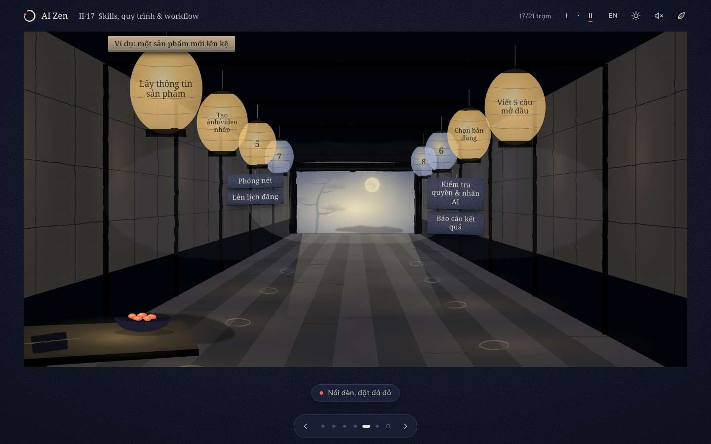
Trạng thái kết: 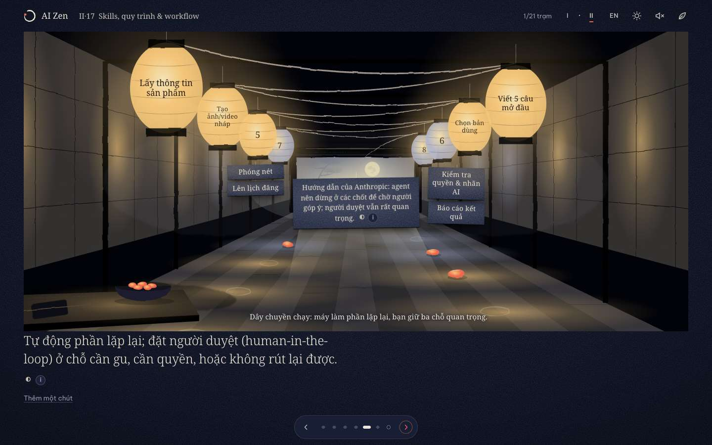
**Hiện tại**
- Thấy: hành lang xưởng ban đêm, 8 đèn lồng xếp so le trái phải lùi về cánh cửa trăng. Biển "Ví dụ: một sản phẩm mới lên kệ". Bát đá son nằm ở tiền cảnh (`t35-5-a`).
- Làm:
  - Prompt "Nối đèn, đặt đá đỏ". Vẽ một nét từ đèn này sang đèn kia (desktop: chạm/click đèn **không ăn**), đặt đá đỏ dưới đèn.
  - Nối đủ 8 đèn thì thuyền giấy **tự chạy ngay**. Tới đá đỏ, thuyền dừng chờ người xem chạm duyệt.
- Chữ trên màn:
  - Tên trạm: "Lấy thông tin sản phẩm · Viết 5 câu mở đầu · Tạo ảnh/video nháp · Chọn bản dùng · Phóng nét · Kiểm tra quyền & nhãn AI · Lên lịch đăng · Báo cáo kết quả".
  - Khi đặt đá: "Chọn cần gu và hiểu thương hiệu." / "Sai về quyền hay nhãn là rủi ro pháp lý." / "Đăng rồi thì khó rút lại."
  - Khi đá thừa: "Đá đỏ ở đây cũng được — nhưng chậm hơn mà không thêm an toàn."
  - Khi thiếu: "Còn {n} chỗ cần người duyệt mà chưa có đá đỏ."
  - Xong: "Dây chuyền chạy: máy làm phần lặp lại, bạn giữ ba chỗ quan trọng." · fact "Hướng dẫn của Anthropic: agent nên dừng ở các chốt để chờ người góp ý; người duyệt vẫn rất quan trọng."
  - Insight: "Tự động phần lặp lại; đặt người duyệt (human-in-the-loop) ở chỗ cần gu, cần quyền, hoặc không rút lại được."
  - Thêm một chút: "Nối với trạm 15: việc gửi đi, trả tiền, xoá dữ liệu thì để agent dừng lại hỏi bạn."

**Lỗi**
1. [GP]
   - Click chuột vào đèn không nối được: `root.setPointerCapture` khiến click không tới nút đèn (DOM: `aria-pressed false`).
   - Vầng sáng `.p2p-lamp-halo` (bán kính khoảng 250px) đè lên tâm các đèn xa, nên trên phone chạm đèn 3 trượt.
   - Làm theo prompt (nối trước, đặt đá sau) thì thuyền chạy ngay khi chưa có viên đá nào, mỗi lượt hơn 15 giây. Trong lúc chạy không đặt được đá, và mỗi viên đá đặt sau lại kích thuyền chạy thêm một lượt. Thử 40 giây vẫn chưa xong. Chỉ khi đặt đá trước rồi mới nối thì xong (18,5 giây).
   - Thuyền chỉ là một chấm sáng nhỏ.
2. [LO]
   - Tấm tên "Phóng nét / Lên lịch đăng" và "Kiểm tra quyền… / Báo cáo kết quả" xếp chồng, không rõ tấm nào của đèn nào. Vòng tròn trên sàn không nằm rõ dưới đèn tương ứng.
   - Phone: 6 đèn xa chồng lên nhau, tên đè tên (`t35-5-p`).
   - Fact lúc xong che mất ô cửa trăng, tức đích đến của cảnh.
3. [CC]
   - Insight thiếu chủ ngữ ("Tự động phần lặp lại").
   - "cần quyền" mơ hồ (quyền truy cập hay quyền hình ảnh, bản quyền?).
   - "human-in-the-loop" là tiếng Anh, tuy có chú giải.
   - "Nối với trạm 15" mơ hồ: II·15 hay I·15? Thực tế là t15 ở Phần 1.
   - Câu "done" và insight nói cùng một ý hai lần.
   - Prompt không nói cách nối (vẽ nét), cũng không nói đá đỏ nghĩa là gì.
4. [LG]
   - Ý nghĩa đá đỏ (người duyệt) chỉ lộ ra sau khi đã đặt.
   - Câu "Còn {n} chỗ…" lộ luôn số đáp án.
   - Khi thiếu người duyệt, hậu quả chỉ là "ánh sáng lao qua", không có hậu quả đời thật nào được nói ra.
5. [Thẩm mỹ] (TM 4) Hành lang phối cảnh một điểm, đèn lồng giấy ấm, cửa cuối có trăng — có chiều sâu thật. Nhưng:
   - Tấm tên dưới đèn là chữ nhật xanh xám như nhãn UI.
   - Vòng trên sàn là nét trắng mảnh như marker.
   - Thuyền giấy chỉ là một chấm sáng.
   - Ván sàn sọc đều phẳng; bàn tiền cảnh là khối thô.
6. [Cân bằng bố cục] (CB 3)
   - **Lúc mở:** phối cảnh đối xứng, cửa ở tâm — tốt. Nhưng tên và số dồn quanh cửa (x 450–980, y 230–470) và chồng lên nhau. Biển "Ví dụ…" đè đầu đèn 1 (x 220–475, y 72–104). 1/3 dưới là sàn trống có vòng mảnh. Bàn đá son nặng ở góc dưới trái.
   - **Lúc kết:** fact card che ô cửa là hero của cảnh; insight dưới trái (`t35-5-d-done`).
7. [Hướng dẫn tương tác] Cử chỉ thật: vẽ một nét qua 8 đèn; kéo hoặc chạm để đặt đá đỏ; chạm đá để duyệt khi thuyền dừng.
   - Đang có: số trên các đèn xa 5–8 (H4 tạm); đèn sáng khi nối (H6).
   - Đang thiếu:
     - click vào đèn không ăn (lỗi);
     - cử chỉ vẽ không có dấu (H2);
     - đích đặt đá là vòng sàn mờ, cỡ 40×16 (H3, dưới 44px);
     - khi thuyền dừng chờ, không có chữ nào bảo "chạm đá để duyệt" (code chỉ hiện chữ ở trạm *không* cần người);
     - H5 (prompt mất), H7.
   - HD 1.

**Đề xuất sửa**
- Gameplay:
  - Click/chạm vào đèn là nối được ngay; chỉ bắt pointer capture khi đã kéo quá 12px.
  - Bỏ halo khỏi vùng chạm (`pointer-events: none`).
  - **Không tự chạy:** nối xong, người xem chạm thuyền ở cửa để thả. Thuyền to hơn, chạy dưới 8 giây.
  - Khi thuyền lao qua một trạm cần người mà không có đá, hiện hậu quả ngay tại trạm đó.
  - Đá thừa vẫn cho qua, nhưng hiện số giây phải chờ thêm.
- Layout: mỗi đèn treo một tấm tên ngay dưới nó, vòng sàn đặt thẳng dưới đèn. Phone: đèn xếp thành hai cột, tên nằm ngang. Fact lúc xong đặt ở khung cửa, không che ô cửa.
- Câu chữ viết sẵn:
  - prompt "Nối 8 đèn, đặt đá đỏ ở chỗ cần bạn duyệt" · nhãn bát "Đá đỏ = bạn duyệt trước khi chạy tiếp" · nút cửa "Thả thuyền"
  - thiếu ở Lên lịch đăng "Không ai duyệt: bài có ảnh người mẫu chưa ký đã lên lịch đăng."
  - thiếu ở Chọn bản "Máy tự chọn bản đầu tiên — sai giọng thương hiệu."
  - thừa "Máy tự làm được việc này — đá đỏ ở đây chỉ làm bạn chờ thêm."
  - done "Thuyền đã ra cửa."
  - insight "Máy chạy phần lặp lại. Bạn giữ ba chỗ: chọn bản cần gu, kiểm quyền hình ảnh, và bấm đăng — vì đăng rồi khó rút lại." (24 từ)
  - Thêm một chút "Việc gửi đi, trả tiền, xoá dữ liệu: luôn để agent dừng lại hỏi bạn (xem trạm I·15 — cần kiểm số hiển thị)."
- Thẩm mỹ:
  - Tấm tên thành tanzaku giấy treo dây dưới mỗi đèn, chữ mực, giấy ngả vàng theo ánh đèn.
  - Vòng sàn thành đế đá lõm có bóng.
  - Thuyền giấy origami to gấp 3 lần, có ánh đom đóm, để lại vệt sáng trên dây.
  - Ván sàn có vân, phản chiếu ánh đèn.
- Bố cục:
  - Đèn xa (5–8) giãn ra theo hai vách; tên đặt so le ngay dưới từng đèn, không chồng nhau.
  - Biển nhiệm vụ lên xà trần ở giữa (x 560–880, y≈80).
  - Lúc kết: fact treo ở khung cửa bên trái (x 450–590), không che ô cửa. Insight dưới-phải, làm đối trọng cho bàn đá son bên trái.
- Hướng dẫn:
  - Đèn 1 mang chấm son kèm vầng thở; nối xong đèn n thì chấm chuyển sang đèn n+1 (H1). Một nét mực mờ vẽ sẵn từ đèn này tới đèn kế (H2).
  - Bát đá son có chấm son. Khi cầm đá lên, 8 đế dưới đèn sáng lên (H3).
  - Bộ đếm "Đèn 0/8 · Đá đỏ 0" (H4).
  - Prompt: "Kéo nét mực từ đèn 1 qua từng đèn" → "Đặt đá đỏ dưới đèn cần bạn duyệt" → "Chạm thuyền ở cửa để thả" → (khi thuyền dừng) "Chạm đá đỏ để duyệt cho thuyền đi tiếp".
  - Đứng yên 6 s: đèn kế tiếp đung đưa.
  - Đế đá ≥ 44px.

### 35-Quiz · Câu hỏi nhỏ   ·   Mức: Sửa nhẹ   ·   Ưu tiên: P3
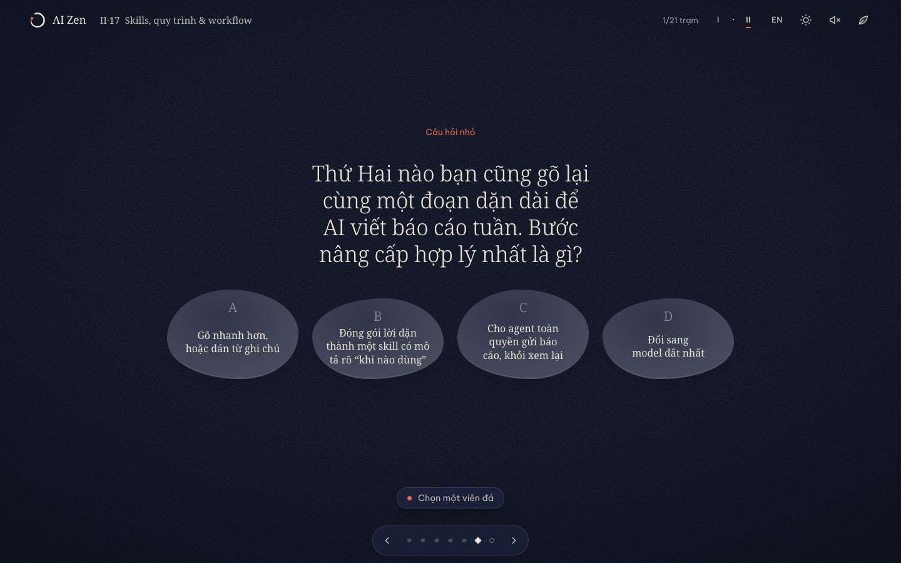
**Hiện tại**
- Chữ: "Thứ Hai nào bạn cũng gõ lại cùng một đoạn dặn dài để AI viết báo cáo tuần. Bước nâng cấp hợp lý nhất là gì?"
  - A "Gõ nhanh hơn, hoặc dán từ ghi chú"
  - B "Đóng gói lời dặn thành một skill có mô tả rõ “khi nào dùng”" (đúng)
  - C "Cho agent toàn quyền gửi báo cáo, khỏi xem lại"
  - D "Đổi sang model đắt nhất"
  - Giải thích: "Skill giữ lời dặn ở một chỗ, AI tự mở khi gặp việc hợp. Còn việc gửi đi vẫn nên chờ bạn duyệt."

**Lỗi**
1. [GP] Đáp án vẫn là B, D là bù nhìn.
2. [LO] ổn.
3. [CC] ổn.
4. [LG] Câu hỏi khớp với slide 1–2. Giải thích có nhắc người duyệt, tốt.
5. [Thẩm mỹ] (TM 2, em tự chấm) Cùng khuôn với quiz 34: 4 đá-nút xám xếp hàng trên nền đen trơn.
6. [Cân bằng bố cục] (CB 3) Câu hỏi 4 dòng và hàng đá ở giữa trên. 1/3 dưới trống.
7. [Hướng dẫn tương tác] ổn (HD 4): prompt "Chọn một viên đá" đúng vật.

**Đề xuất sửa**
- Câu chữ viết sẵn: A "Lưu đoạn dặn vào ghi chú, mỗi tuần dán lại" · B "Giao agent tự viết và tự gửi, khỏi xem lại" · C "Đóng gói thành một skill có mô tả rõ “khi nào dùng”" (đúng) · D "Viết đoạn dặn dài hơn cho chắc". Giữ nguyên giải thích.
- Thẩm mỹ: như quiz 34 — đá cuội thật trên mặt nước có bóng trăng.
- Bố cục: như quiz 34 — đá xếp cong, câu hỏi lên 1/4 trên.
- Hướng dẫn: giữ; thêm vầng thở khi đứng yên 6 s.

### 35-Ensō · Tóm lại trong 1 câu   ·   Mức: Giữ   ·   Ưu tiên: P3
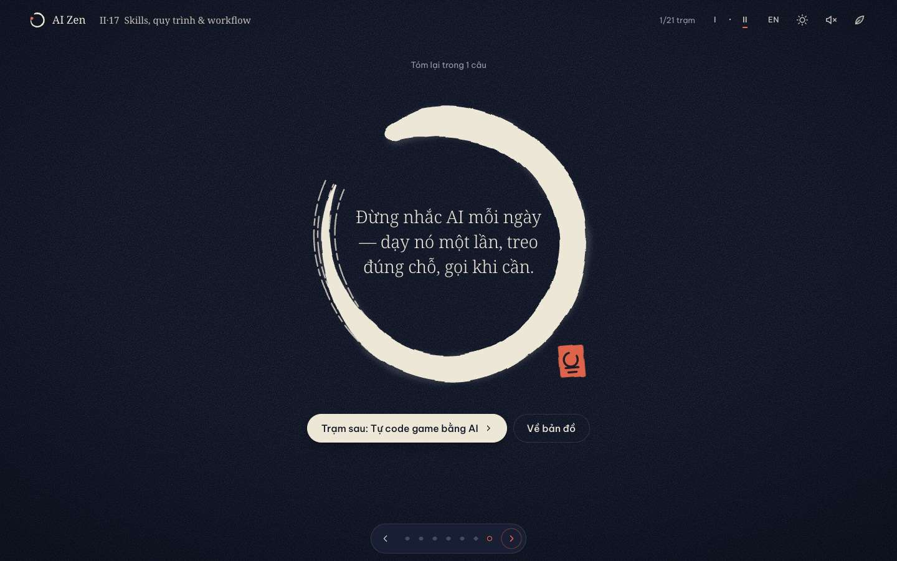
**Hiện tại**
- Chữ: "Đừng nhắc AI mỗi ngày — dạy nó một lần, treo đúng chỗ, gọi khi cần." Nút "Trạm sau: Tự code game bằng AI".

**Lỗi**
1. [GP] ổn.
2. [LO] ổn.
3. [CC] "treo đúng chỗ" là ẩn dụ, đã được giải mã nhờ vách treo cuộn ở slide 2. Ổn.
4. [LG] Thiếu ý người duyệt.
5. [Thẩm mỹ] ổn (TM 4): cùng khuôn ensō có nét cọ và ấn son.
6. [Cân bằng bố cục] ổn (CB 4): đặt ở tâm, câu 3 dòng nằm gọn trong vòng.
7. [Hướng dẫn tương tác] ổn (HD 4): nút rõ.

**Đề xuất sửa**
- Câu chữ viết sẵn (tuỳ chọn): "Dạy AI một lần bằng skill, chỉ tự động tới mức vừa đủ, và giữ cho mình những chỗ cần duyệt."
- Thẩm mỹ: giữ.
- Bố cục: giữ.
- Hướng dẫn: giữ.

---

## Trạm 36 · Tự code game bằng AI (II·18)
**Mục tiêu học (1 câu):** Tự làm được một game nhỏ bằng AI: viết spec rõ, chọn công nghệ, thêm từng tính năng có lưu mốc, và biết khi nào phải có người đọc kỹ code.

**Mạch hiện tại:** 1 Bản vẽ trước khi đẽo → 2 Chọn bút → 3 Bảy bước đẽo game → 4 Game lớn dần từng lớp → 5 Viết theo cảm giác có đủ? → quiz → ensō.

**Vấn đề mạch:**
- Slide 3 và 4 cùng dạy "từng bước nhỏ, lưu mốc"; hai insight gần như trùng chữ.
- Slide 3 trộn lệnh cài đặt một lần (Vite, npm, deploy) với vòng lặp tính năng.
- Quiz hỏi cách báo lỗi, nhưng thẻ "Prompt báo lỗi chuẩn" không được đưa ra trong trạm. Trong 7 thẻ ở `takeaways`, chỉ 3 thẻ xuất hiện trong slide.

**Mạch đề xuất:** 1 Bản vẽ (mơ hồ hay rõ) → 2 Chọn bút → 3 Vòng đẽo có mốc: thêm từng tính năng, gặp lỗi, quay về mốc (gộp 3+4; thẻ "Prompt thêm tính năng", "Prompt báo lỗi chuẩn") → 4 Chơi thử 30 giây (thẻ bộ prompt) → 5 Code theo cảm giác có đủ không? → quiz → ensō. Lệnh cài đặt và đăng game chuyển vào thẻ "Prompt dựng khung" và "Checklist trước khi đăng game".

**Kicker / tóm tắt / thẻ mang về hiện tại:**
- Kicker: "Không cần biết đẽo gỗ — cần biết vẽ bản vẽ thật rõ cho người thợ." → **lỗi:** ẩn dụ (đẽo gỗ = viết code, người thợ = AI) không được giải mã. Slide 3 lại cho chính người xem "đẽo", ngược với kicker. → **đề xuất:** "Bạn không cần tự viết code — AI là người thợ; việc của bạn là vẽ bản vẽ thật rõ và kiểm từng nhát."
- Tóm tắt: "Người làm game bằng AI giỏi nhất không phải người gõ code nhanh — mà là người mô tả rõ và sửa từng bước nhỏ." → ổn (24 từ).
- Thẻ mang về: 7 thẻ; slide đưa ra "Mẫu spec game 1 trang", "Prompt dựng khung", "Bộ prompt làm lại…". → **lỗi:** "Prompt thêm tính năng", "Prompt báo lỗi chuẩn", "Prompt tối ưu cho điện thoại", "Checklist trước khi đăng game" không có slide nào đưa ra. → **đề xuất:** gắn hai thẻ đầu vào vòng đẽo (slide 3 mới), hai thẻ sau vào ensō dạng "4 thẻ nữa".

Điểm: Gameplay 6/10 · Layout 6/10 · Câu chữ 5/10 · Logic thông tin 5/10 · Thẩm mỹ 6/10 · Cân bằng 5/10 · Hướng dẫn 5/10

### 36-1 · Bản vẽ trước khi đẽo   ·   Mức: Sửa nhẹ   ·   Ưu tiên: P2
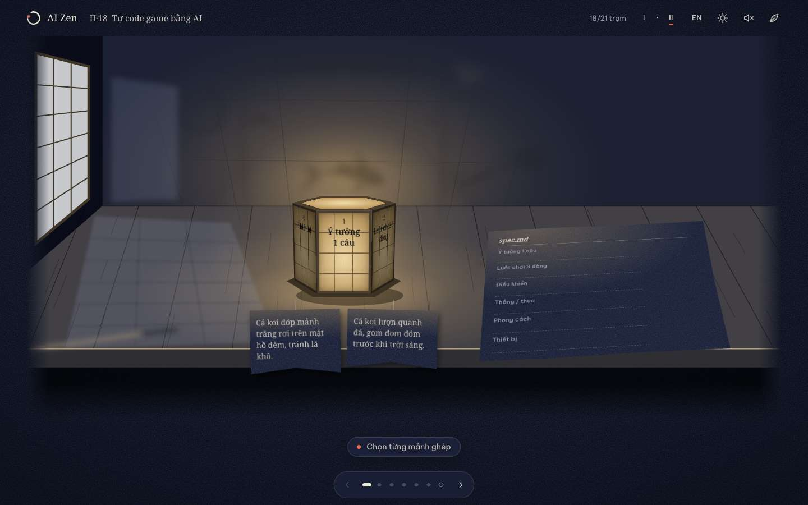
Trạng thái kết: 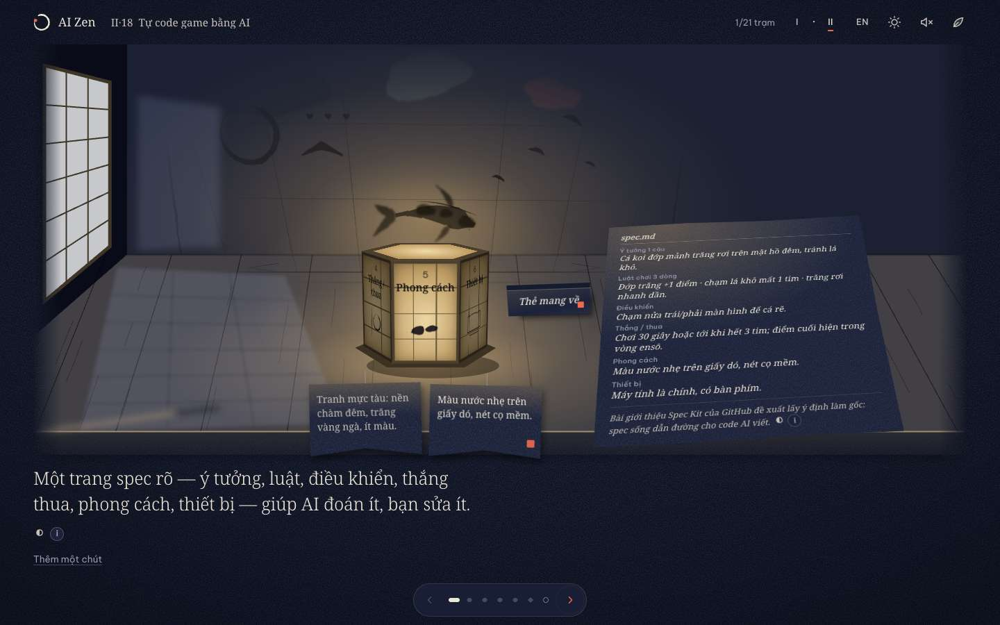
**Hiện tại**
- Thấy: phòng vẽ tối, đèn andon 6 mặt nhỏ giữa bàn, hai dải giấy treo dưới mặt trước, tấm "spec.md" bên phải ghi 6 dòng trống (`t36-1-a`).
- Làm: prompt "Chọn từng mảnh ghép". Chạm 1 trong 2 dải: dải dán lên mặt đèn, dòng đó điền vào spec.md, bóng trên vách thêm một mảng, đèn tự xoay sang mặt sau. Làm đủ 6 lần. Kéo ngang để xoay đèn thì không ăn khi thử.
- Chữ trên màn:
  - Mặt đèn: "Ý tưởng 1 câu · Luật chơi 3 dòng · Điều khiển · Thắng / thua · Phong cách · Thiết bị".
  - Dải (ví dụ): "Cá koi đớp mảnh trăng rơi trên mặt hồ đêm, tránh lá khô." / "Cá koi lượn quanh đá, gom đom đóm trước khi trời sáng."
  - Fact: "Bài giới thiệu Spec Kit của GitHub đề xuất lấy ý định làm gốc: spec sống dẫn đường cho code AI viết."
  - Insight: "Một trang spec rõ — ý tưởng, luật, điều khiển, thắng thua, phong cách, thiết bị — giúp AI đoán ít, bạn sửa ít."
  - Thêm một chút: "Thêm hai dòng đáng giá: “chưa làm ở bản đầu”… và “thế nào là xong”…"

**Lỗi**
1. [GP] Chỉ là chọn 1 trong 2 thẻ, 6 lần, và cả hai đều là spec tốt. **Không có đối chứng giữa rõ và mơ hồ**, nên câu "AI đoán ít" chưa được chứng minh.
2. [LO] Đèn nhỏ giữa phòng rộng. Bóng cuối trên vách chỉ là vài mảng (tim, vòng, chim/đom đóm), không ra hình game hồ koi, nên khoảnh khắc "thấy game trước khi có code" không tới (`t36-1-c-done`). Nhãn "Thẻ mang về" đè lên mép spec.md.
3. [CC]
   - "spec", "spec.md" không được giải thích.
   - "lấy ý định làm gốc", "spec sống" là văn dịch máy.
   - Prompt nói "mảnh ghép" trong khi vật trên màn là dải giấy.
   - Insight liệt kê lại 6 mục đã thấy, như sách giáo khoa.
4. [LG] Hai dòng quan trọng nhất của một spec ("chưa làm ở bản đầu", "thế nào là xong") nằm trong "Thêm một chút", không có trên đèn.
5. [Thẩm mỹ] (TM 3) Đèn andon có giấy, nan gỗ, ánh ấm — tốt, nhưng quá nhỏ. Ngoài ra:
   - Hai dải giấy là card xanh tím có chữ, kiểu UI.
   - spec.md là một tấm card lớn nằm nghiêng.
   - Cửa shōji bên trái và vách sau đều phẳng.
   - Bóng game trên vách chỉ là vài mảng mờ.
6. [Cân bằng bố cục] (CB 2)
   - **Lúc mở:** đèn ở giữa-trái (x 520–710, y 350–520), chỉ chiếm khoảng 3% khung. Card spec.md (x 860–1300, y 400–640) nặng hơn cả hero. Nửa trên (y 64–350) là vách trống.
   - **Lúc kết:** bóng game lên 1/3 trên giữa, insight dưới trái, spec bên phải — tạm cân, nhưng hero vẫn nhỏ (`t36-1-c-done`).
7. [Hướng dẫn tương tác] Cử chỉ thật: chạm một dải giấy; tuỳ chọn kéo ngang để xoay đèn.
   - Đang có: dải giấy rõ là vật chạm; đèn tự xoay sang mặt kế (H6); spec.md điền dần, trên phone có dòng "0/6 dòng đã điền" (H4).
   - Đang thiếu: H1 (không có chấm son); kéo xoay không có dấu (mũi tên cong) và không ăn khi thử; H5 ("Chọn từng mảnh ghép" mất sau lần chạm đầu).
   - HD 3.

**Đề xuất sửa**
- Gameplay:
  - Mỗi mặt có một dải **mơ hồ** và một dải **rõ**. Chọn mơ hồ thì cung bóng đó vẫn nhoè và spec.md ghi "AI tự đoán: ???"; chọn rõ thì cung đó nét.
  - Sau 6 mặt, spec.md mọc thêm hai dòng trống "Chưa làm ở bản đầu" và "Xong khi", chạm để điền.
  - Bóng cuối phải là khung game đọc được: vành hồ, cá, trăng rơi, 3 tim.
- Layout: đèn to hơn khoảng 1,5 lần. Nhãn "Thẻ mang về" đặt dưới spec.md.
- Câu chữ viết sẵn:
  - prompt "Chọn một dải giấy cho mỗi mặt đèn"
  - giải mã ở spec.md "spec.md = tờ mô tả game; AI đọc tờ này trước khi viết code"
  - cặp dải: "Một game về cá cho vui" / "Cá koi đớp mảnh trăng rơi, tránh lá khô" · "Có điểm, khó dần" / "Đớp trăng +1 · chạm lá khô mất 1 tim · trăng rơi nhanh dần" · "Điều khiển dễ dùng" / "Kéo hoặc chạm, cá bơi theo ngón tay" · "Chơi tới khi chán" / "30 giây hoặc hết 3 tim thì hiện điểm" · "Đẹp, nghệ thuật" / "Tranh mực: nền chàm, trăng vàng ngà, ít màu" · "Chạy mọi nơi" / "Điện thoại dọc là chính"
  - fact "GitHub (Spec Kit) khuyên: viết rõ điều bạn muốn trước, rồi để bản mô tả đó dẫn đường cho AI viết code."
  - insight "Dải mơ hồ để bóng nhoè: AI phải tự đoán. Dải rõ làm bóng nét — đó chính là game AI sẽ làm ra." (21 từ)
  - Thêm một chút "Hai dòng cuối giúp AI khỏi làm quá tay và giúp bạn biết khi nào dừng."
- Thẩm mỹ:
  - Đèn andon to gấp 1,6 lần, giấy có sợi, khung gỗ đổ bóng nan lên bàn.
  - Dải giấy thành tanzaku giấy dó treo dây dưới đèn, chữ mực, không nền màu.
  - spec.md là tờ giấy thật nằm trên bàn, có chặn giấy, chữ viết tay.
  - Bóng game trên vách vẽ rõ vành hồ, cá, trăng rơi (bóng in đen, nét mềm).
- Bố cục:
  - Đèn vào tâm, hơi thấp (x 600–860, y 330–600). Bóng game chiếm 1/3 trên vách sau làm điểm đến của mắt.
  - spec.md thu nhỏ, đặt ở mép bàn phải-trước (x 1000–1300, y 620–760).
- Hướng dẫn:
  - Hai dải ở mặt trước mang chấm son (H1).
  - Quanh đáy đèn có mũi tên cong mực mờ và chữ nhỏ "kéo để xoay" (cử chỉ ẩn).
  - Quanh đèn có 6 chấm đánh dấu những mặt đã chọn (H4).
  - Prompt: "Chọn một dải cho mặt ‘Ý tưởng’" → "Mặt ‘Luật chơi’: chọn một dải" → …
  - Đứng yên 6 s: dải chưa chọn đung đưa nhẹ.

### 36-2 · Chọn bút   ·   Mức: Giữ   ·   Ưu tiên: P3
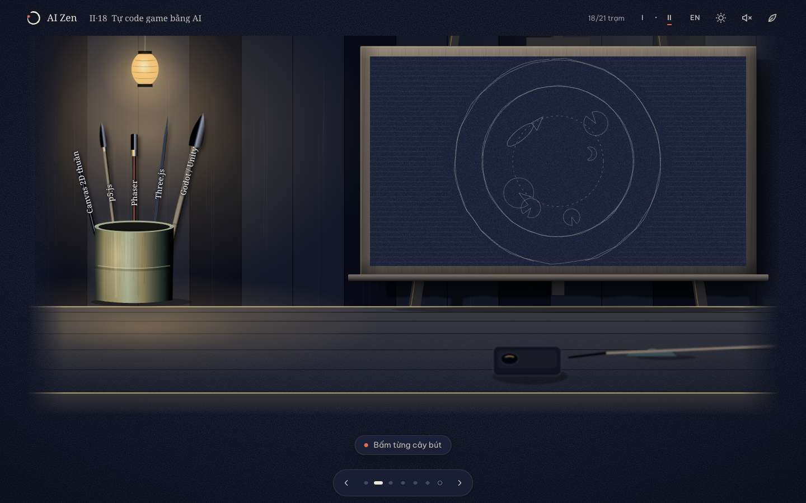
Trạng thái kết: 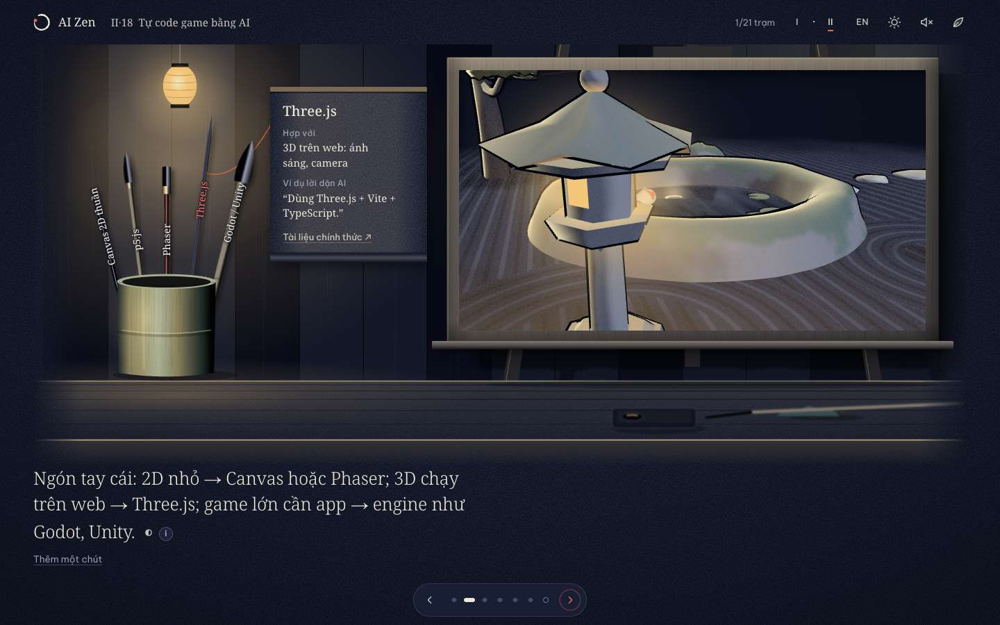
**Hiện tại**
- Thấy: ống bút tre cắm 5 cây bút dưới đèn, giá vẽ có khung tranh hồ koi (`t36-2-a`).
- Làm: prompt "Bấm từng cây bút". Mỗi bút đổi chất liệu khung:
  - Canvas: hồ phẳng, kéo thì tờ giấy trượt.
  - Three.js: hồ 3D thật, kéo thì xoay hồ.
  - Godot/Unity: lùi ra thấy cả vườn trong khung tablet (`t36-2-b-canvas`, `-d-engine`).
- Chữ trên màn:
  - Tag (ví dụ): "Canvas 2D thuần · Hợp với: Game 2D đơn giản, nhẹ nhất · Ví dụ lời dặn AI: “Dùng HTML Canvas 2D, không thư viện.” · Tài liệu chính thức ↗"
  - Các bút khác: p5.js "Người mới, nghệ thuật tạo sinh"; Phaser "Game 2D có màn, sprite, va chạm" + fact "Phaser đã sang dòng 4; bản mới nhất khi kiểm tra là 4.2.1, phát hành ngày 9/7/2026."; Three.js "3D trên web: ánh sáng, camera"; Godot/Unity "Game lớn, xuất app điện thoại/PC".
  - Insight: "Ngón tay cái: 2D nhỏ → Canvas hoặc Phaser; 3D chạy trên web → Three.js; game lớn cần app → engine như Godot, Unity."
  - Thêm một chút: "Không có bút “tốt nhất”…"

**Lỗi**
1. [GP] Insight hiện sau 2 lần bấm bút, chưa cần kéo, nên khác biệt "cảm bằng tay" có thể bị bỏ qua.
2. [LO] Ở Three.js, kéo xoay làm đèn đá che gần hết khung và mất cá (`t36-2-c-three`).
3. [CC]
   - "Ngón tay cái:" là dịch máy từ "rule of thumb".
   - Thuật ngữ chưa giải thích: "sprite", "nghệ thuật tạo sinh", "engine", "Vite", "TypeScript", "GDScript", "CDN".
   - Fact phiên bản Phaser là chi tiết vụn với khán giả này (cần kiểm nguồn số 4.2.1 và ngày 9/7/2026).
4. [LG] Mạch đúng: thấy → thử → quy tắc.
5. [Thẩm mỹ] ổn (TM 5 — mốc chuẩn của calibration): ống bút có khối, đèn treo ấm, khung tranh 3D thật, chất liệu đổi theo bút. Chỉ có hai điểm nhỏ:
   - Tag bút là card xanh chữ nhật (`t36-2-b-canvas`).
   - Ở bút Three.js, camera để đèn đá che gần hết hồ.
6. [Cân bằng bố cục] ổn (CB 4): ống bút ở 1/3 trái làm đối trọng cho khung tranh 2/3 phải. Dải bàn dưới (y 560–700) hơi trống; nghiên nằm đơn độc ở giữa-phải.
7. [Hướng dẫn tương tác] Cử chỉ thật: chạm bút; kéo trong khung tranh.
   - Đang có: bút rõ ràng, nhãn nằm ngay trên thân bút (giống nhãn "Agent/Bạn" của Phần 1); nét cọ quét qua khi đổi bút (H6); `frameHint` hiện sau 12 s đứng yên (H7, theo code `idle: 12`).
   - Đang thiếu: H1 (chấm son trên bút); dấu kéo trong khung; H4 ("đã thử 2/5").
   - HD 4.

**Đề xuất sửa**
- Gameplay: chờ người xem đã kéo ở một bút phẳng và một bút 3D rồi mới hiện insight. Giới hạn góc xoay để đèn đá không che hồ.
- Câu chữ viết sẵn:
  - p5.js "Hợp với: người mới, tranh vẽ bằng code"
  - Phaser "Hợp với: game 2D nhiều màn, nhân vật hoạt hình, va chạm"
  - ghi chú dưới lời dặn "Chép nguyên câu này cho AI; chữ lạ trong đó là tên công cụ, AI tự hiểu."
  - insight "Mẹo chọn nhanh: game 2D nhỏ → Canvas hoặc Phaser; 3D chạy trên web → Three.js; game lớn cần app → Godot hoặc Unity." (22 từ)
  - fact Phaser chuyển xuống "Thêm một chút".
- Thẩm mỹ: tag bút thành ống giấy cuộn có dây, như art direction mô tả. Giới hạn góc camera để đèn đá không che hồ.
- Bố cục: đặt thêm nghiên và một tờ nháp ở bàn dưới, trái-giữa, để lấp dải trống.
- Hướng dẫn:
  - Bút chưa thử có chấm son (H1).
  - Sau khi chọn bút, góc khung hiện dấu tay kéo mờ: ↔ cho bút phẳng, ↻ cho bút 3D.
  - Thêm "Đã thử 1/5 bút". Rút `frameHint` xuống 6 s.

### 36-3 · Bảy bước đẽo game   ·   Mức: Làm lại   ·   Ưu tiên: P2
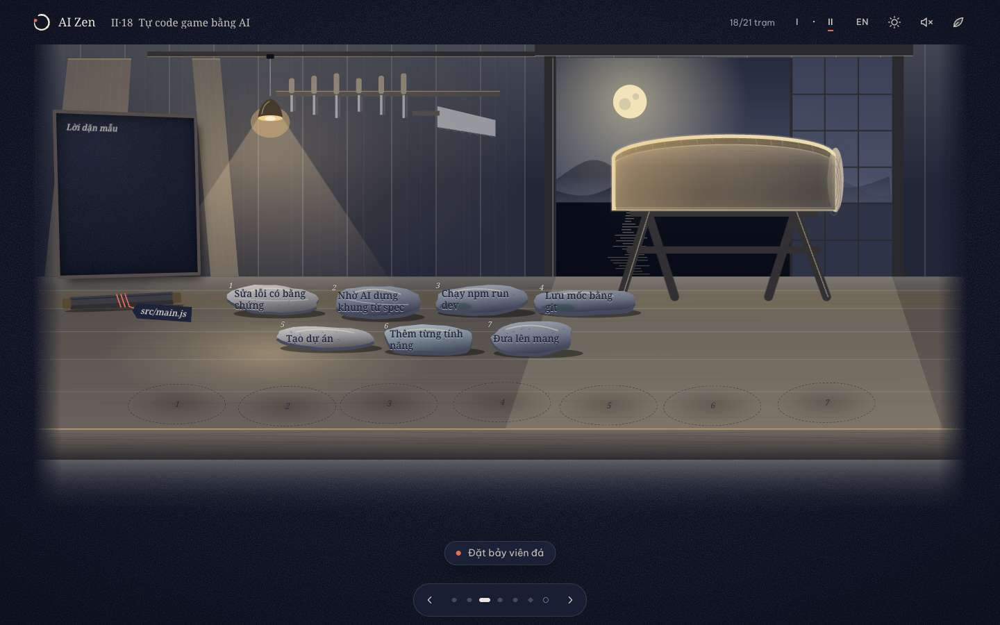
Trạng thái kết: 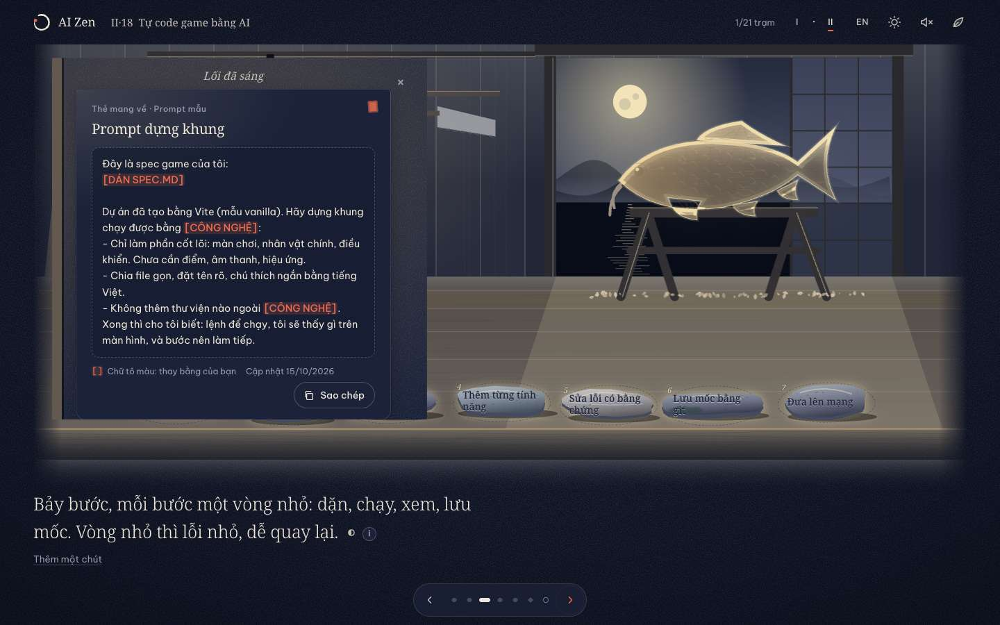
**Hiện tại**
- Thấy: xưởng mộc nhìn ngang mặt bàn, khối gỗ trên giá chạm trước ô cửa trăng, bảng đen "Lời dặn mẫu", cuộn "src/main.js", 7 viên đá đánh số, 7 hốc đánh số (`t36-3-a`).
- Làm: prompt "Đặt bảy viên đá". Chạm đá theo thứ tự đúng: khối gỗ thành hình cá thêm một bậc, phoi gỗ bay, bảng đen hiện câu dặn của bước. Xong thì thẻ "Prompt dựng khung" mở ra. Đèn làm việc kéo được, nhưng không dạy gì.
- Chữ trên màn:
  - Đá: "1 Sửa lỗi có bằng chứng · 2 Nhờ AI dựng khung từ spec · 3 Chạy npm run dev · 4 Lưu mốc bằng git · 5 Tạo dự án · 6 Thêm từng tính năng · 7 Đưa lên mạng".
  - Khi đúng: "4. Thêm từng tính năng — Mỗi lần dặn một việc, chạy thử, rồi mới dặn việc sau."
  - Bảng đen: "4 · Lời dặn mẫu · Thêm đúng một tính năng: lá khô rơi chậm, cá chạm thì mất 1 tim. Giữ nguyên mọi thứ khác."
  - Chi tiết các bước: "Gõ npm create vite@latest, chọn mẫu vanilla. Cần Node.js 20.19+ hoặc 22.12+." · "Mở http://localhost:5173…" · "Dán lỗi trong Console (phím F12)…" · "Sau mỗi bước chạy được: git add . rồi git commit -m "thêm lá khô"." · "npm run build tạo thư mục dist…".
  - Insight: "Bảy bước, mỗi bước một vòng nhỏ: dặn, chạy, xem, lưu mốc. Vòng nhỏ thì lỗi nhỏ, dễ quay lại."

**Lỗi**
1. [GP] Quiz xếp đá lần thứ ba trong vườn. Sau khi đặt, trên màn có hai số "1" và hai số "4" cùng lúc (`t36-3-c-mid`). Kéo đèn không có tác dụng học.
2. [LO] Thẻ prompt to che nửa trái màn hình lúc xong (`t36-3-d-done`). Phone: chữ trên đá khoảng 10px, khối gỗ bị bạc trắng trong light mode (`t36-3-p`).
3. [CC]
   - Lệnh chưa giải thích cho người không code: "npm run dev", "git", "Node.js 20.19+", "mẫu vanilla", "localhost:5173", "dist", "Console (F12)".
   - Câu về Vite/Node xuất hiện hai lần (trong chi tiết bước 1 và trong fact).
   - Lời dặn mẫu của bước "Chạy npm run dev" lại là lời báo lỗi ("Tôi chạy npm run dev nhưng không thấy gì…"), lệch với bước.
   - Lời dặn của bước git chỉ là "Gợi ý cho tôi một câu commit ngắn", không dạy được cách lưu mốc hay quay lại.
4. [LG]
   - **Mâu thuẫn:** chi tiết bước git ghi "Sau mỗi bước chạy được", insight ghi "mỗi bước… lưu mốc", nhưng luật chơi cho git là **một viên đá duy nhất ở vị trí 6**, tức dạy commit một lần gần cuối.
   - "Tạo dự án" và "Đưa lên mạng" làm một lần, không phải "vòng nhỏ", nên câu "Bảy bước, mỗi bước một vòng nhỏ" sai.
   - Kicker nói bạn không cần đẽo, nhưng slide bắt người xem đẽo.
5. [Thẩm mỹ] (TM 3) Xưởng mộc có đèn làm việc, giá đục, cửa trăng, khối gỗ trên giá — ổn. Cá đẽo dần lên trông đẹp (`t36-3-c-mid`). Nhưng:
   - 7 viên đá là đá-nút xám có chữ, xếp 2 hàng (calibration (a)).
   - Hốc là elip nét đứt, trông như ô UI.
   - Bảng đen "Lời dặn mẫu" là chữ nhật trống lớn.
6. [Cân bằng bố cục] (CB 3)
   - **Lúc mở:** bảng đen bên trái (x 80–290, y 160–400) và khối gỗ bên phải (x 880–1210, y 190–430) cân nhau. Hàng đá (x 320–920, y 400–520) và hàng hốc (y 550–610) tạo thành hai dải ngang. Dưới bàn (y 660–900) trống.
   - **Lúc kết:** thẻ prompt che nửa trái (x 90–610, y 85–605), insight ở dưới — lệch hẳn sang trái (`t36-3-d-done`).
7. [Hướng dẫn tương tác] Cử chỉ thật: chạm đá theo thứ tự; tuỳ chọn kéo đèn hoặc chạm cuộn mã.
   - Đang có: hốc có số 1–7 (H3); cá đổi hình, phoi bay khi đặt đúng (H6).
   - Đang thiếu: H1; số trên đá trùng số hốc (sau khi đặt, trên màn có hai số "1" và hai số "4" — `t36-3-c-mid`); kéo đèn và chạm cuộn không có dấu; H5 ("Đặt bảy viên đá" mất sau lần chạm đầu); H7.
   - HD 2.

**Đề xuất sửa**
- Gameplay (concept mới, **vòng đẽo có mốc**, gộp với 36-4 nếu được):
  - Mỗi tính năng là một nhát vồ. Xong nhát nào, một viên đá mốc (bản lưu) tự rơi vào hàng.
  - Ở nhát thứ 4 ("lá khô"), khối gỗ nứt và phấn ghi "cá đứng yên".
  - Người xem chọn "Đẽo tiếp" (vết nứt lan) hoặc "Quay về mốc 3" (khối gỗ lành lại).
  - Lệnh cài đặt và đăng game chuyển vào thẻ.
- Layout: bỏ đèn kéo. Thẻ chỉ mở khi chạm cuộn trên bàn.
- Câu chữ viết sẵn:
  - nhãn "Đẽo từng nhát, lưu từng mốc" · prompt "Gõ vồ để thêm một tính năng"
  - giải mã "Mốc = một bản lưu của game (git commit); hỏng thì quay về được."
  - nút "Đẽo tiếp" / "Quay về mốc trước" · phấn khi lỗi "Thêm lá khô xong thì cá đứng yên."
  - insight "Mỗi tính năng một nhát, xong nhát nào lưu mốc nhát đó. Hỏng thì quay về mốc trước, không phải đẽo lại từ đầu." (23 từ)
  - Thêm một chút "Bạn không cần nhớ lệnh git: dặn AI “lưu mốc cho thay đổi vừa rồi” hoặc “quay về mốc trước” là đủ."
- Thẩm mỹ:
  - Concept mới, bỏ hàng đá: một cây vồ gỗ cán mòn đặt cạnh khối gỗ.
  - Mỗi mốc là một viên cuội thật rơi vào khay gỗ cạnh giá, có bóng và tiếng gõ.
  - Vết nứt vẽ như nứt gỗ thật, có dăm.
  - Bảng đen thành tấm bảng gỗ, chữ phấn chỉ hiện khi có lời dặn.
- Bố cục:
  - Khối gỗ hero dời vào tâm-phải (x 760–1200). Vồ ở 1/3 dưới giữa. Khay mốc chạy ngang mép bàn trước (y 600–660).
  - Thẻ mang về chỉ mở khi chạm cuộn, nổi nhỏ ở trên-trái. Insight dưới-phải.
- Hướng dẫn:
  - Vồ mang chấm son kèm vầng thở (H1). Khối gỗ có vạch phấn ở chỗ sắp đẽo (H3). Khay ghi "Mốc 0/6" (H4).
  - Khi nứt: hai nút gỗ "Đẽo tiếp" và "Quay về mốc 3", cỡ ≥ 44px; nút quay về mang chấm son.
  - Prompt: "Gõ vồ để thêm: mặt hồ" → "Thêm cá koi" → "Thêm lá khô — có gì đó hỏng" → "Quay về mốc trước".
  - Đứng yên 6 s: vồ nhấc lên nhẹ.

### 36-4 · Game lớn dần từng lớp   ·   Mức: Sửa nhẹ   ·   Ưu tiên: P2
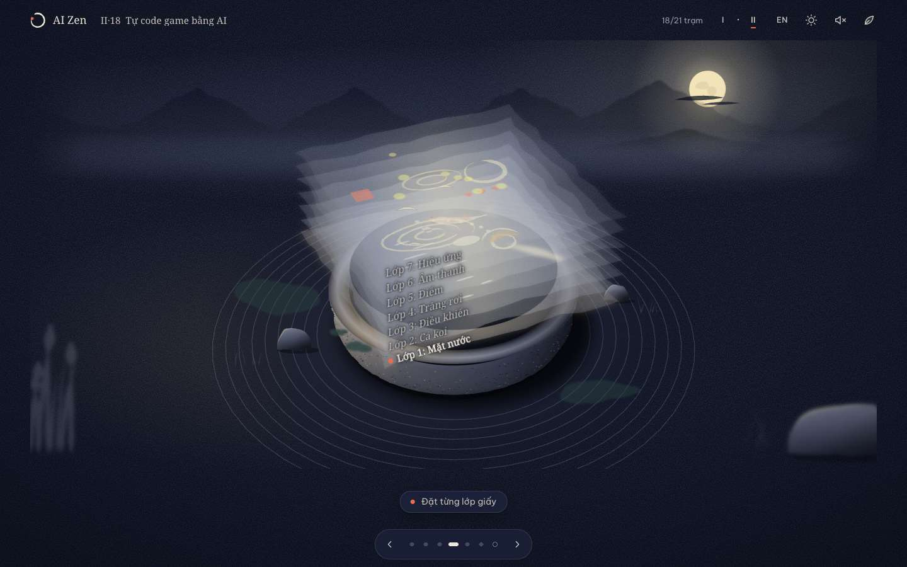
Trạng thái kết: 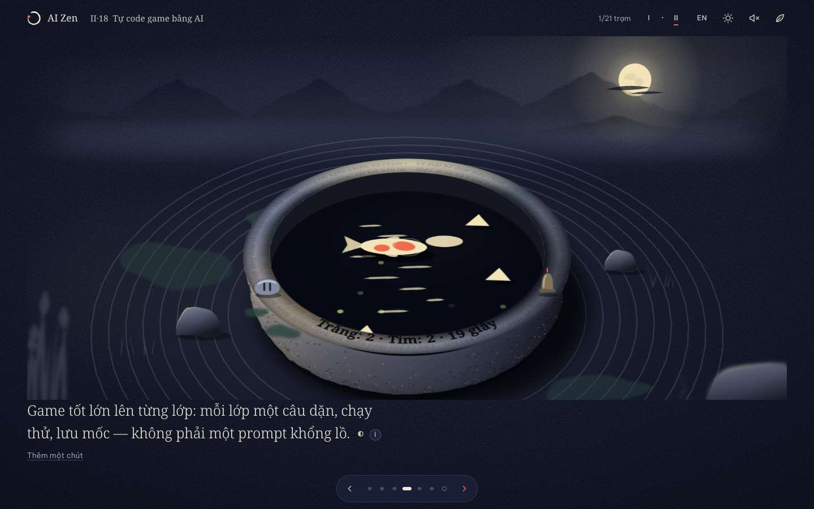
**Hiện tại**
- Thấy: chậu đá tròn lơ lửng trong tối, phía trên là 7 tờ giấy can chồng nhau. Mép tờ ghi "Lớp 7… Lớp 1" thành một cột chữ nghiêng (`t36-4-a`).
- Làm:
  - Prompt "Đặt từng lớp giấy". Chỉ tờ đang sáng mới chạm được (chạm "Lớp 7" trước thì không có phản hồi). Tờ hạ vào chậu, câu dặn hiện ra.
  - Đủ 7 lớp thì nút "Chơi thử 30 giây" xuất hiện. Game chơi được thật, kết thúc bằng ensō có điểm (`t36-4-e-end`).
- Chữ trên màn:
  - Mỗi lớp: "Lớp 3: Điều khiển · Câu dặn đã tạo ra lớp này · Cho cá bơi theo ngón tay hoặc chuột, lượn mềm; máy tính dùng thêm phím mũi tên." + fact lặp lại ở mọi lớp "Câu dặn đi kèm mỗi lớp là minh hoạ cách chia nhỏ, không phải nhật ký thật của game trong app."
  - Lớp 4: "Thả mảnh trăng rơi ngẫu nhiên, cá chạm thì +1 điểm. Thêm lá khô: chạm thì mất 1 tim."
  - Lớp 5: "Hiện điểm và 3 tim ở góc; hết 30 giây hoặc hết tim thì hiện điểm trong vòng ensō, có nút chơi lại."
  - Insight: "Game tốt lớn lên từng lớp: mỗi lớp một câu dặn, chạy thử, lưu mốc — không phải một prompt khổng lồ."
  - Thêm một chút: "Hết ván, mở thẻ mang về: bộ prompt đầy đủ…"
  - Trong game: "Trăng: 2 · Tim: 2 · 19 giây" · cuối ván "Ván kết thúc — 10 mảnh trăng · Chơi lại · Thẻ mang về".

**Lỗi**
1. [GP] Thứ tự bị khoá, không có hậu quả, nên người xem không thấy *vì sao* phải theo thứ tự. Trong game, mảnh trăng và lá khô cùng màu kem (tam giác, elip), khó phân biệt (`t36-4-d-play`).
2. [LO] Nhãn các lớp chồng thành một cột chữ như menu. HUD chạy cong theo vành chậu, khó đọc.
3. [CC]
   - "prompt khổng lồ" là tiếng Anh sót.
   - Fact "không phải nhật ký thật của game trong app" khó hiểu, và lặp lại ở mỗi lớp.
   - Insight gần trùng chữ với insight 36-3 ("dặn, chạy, lưu mốc").
4. [LG]
   - **Câu dặn trên màn tự phá quy tắc:** lớp 4 gộp 2 tính năng (trăng + lá khô) và nhắc "tim" khi tim chưa có (tim tới lớp 5 mới có). Lớp 5 gộp 3 việc (điểm, tim, kết thúc).
   - Như vậy trái với 36-3 ("Mỗi lần dặn một việc") và với chính thẻ mang về (thẻ tách trăng và lá khô).
   - Slide này không có hình ảnh "lưu mốc" nào, nhưng insight lại nói "lưu mốc".
5. [Thẩm mỹ] (TM 2)
   - 7 tờ giấy can trong suốt chồng lên nhau thành một khối mờ rối.
   - Nhãn "Lớp 7…1" chữ nghiêng chồng thành danh sách; nội dung từng tờ (vòng, chấm vàng, ô đỏ) như sticker.
   - Chậu đá và gợn nước thì đẹp.
   - Trong game (`t36-4-d-play`) cá đẹp, nhưng trăng và lá chỉ là tam giác, elip màu kem phẳng.
6. [Cân bằng bố cục] (CB 2)
   - **Lúc mở:** chồng giấy và chậu ở giữa (x 470–1000, y 170–620); chồng giấy lệch lên, che tầm nhìn tới trăng. Góc dưới trái có cây cói mờ; dưới phải có tảng đá bị cắt mép. Vùng dưới trăng (x 1050–1390, y 180–500) trống.
   - **Lúc chơi:** chậu ở tâm, insight dưới trái — cân hơn (khoảng 3).
7. [Hướng dẫn tương tác] Cử chỉ thật: chạm tờ đang sáng; kéo xoay chồng giấy (ẩn); khi chơi, kéo hoặc chạm để dẫn cá.
   - Đang có: tờ đang sáng mang chấm son "• Lớp 1: Mặt nước" (H1) — slide duy nhất của vườn có chấm son đúng chuẩn Phần 1; câu dặn hiện khi thả (H6); nút "Chơi thử 30 giây" rõ.
   - Đang thiếu: chạm tờ khác là dead click, không phản hồi (H6); cử chỉ xoay không có dấu; H4 ("Lớp 3/7").
   - Nút tạm dừng 40×28 và bật tiếng 30×36, đều dưới 44px.
   - Em chưa kiểm dòng `play.how` ("Kéo hoặc chạm để dẫn cá…") có hiện trên màn trước khi chơi hay không (cần kiểm).
   - HD 3.

**Đề xuất sửa**
- Gameplay:
  - Chạm tờ nào cũng được. Thả sai thứ tự thì hồ cho thấy lỗi: "Điều khiển" trước "Cá koi" thì có vệt tay mà không có cá; "Kết thúc ván" trước "Trăng rơi" thì đồng hồ chạy mà không có gì để đớp. Tờ đó tự bay về.
  - Trăng vẽ thành liềm vàng, lá khô thành lá nâu.
- Layout: tên lớp nằm ở mép phải từng tờ, so le. HUD nằm thẳng ở mép trên chậu.
- Câu chữ viết sẵn:
  - prompt "Chạm một tờ giấy để thả vào chậu"
  - 7 lớp, mỗi lớp một việc:
    1. "Mặt nước: Vẽ mặt hồ đêm màu chàm, gợn sóng nhẹ."
    2. "Cá koi: Thêm một cá koi trắng đỏ, thân uốn khi bơi."
    3. "Điều khiển: Cho cá bơi theo ngón tay hoặc chuột."
    4. "Trăng rơi: Thả mảnh trăng rơi; cá chạm thì +1 điểm."
    5. "Lá khô: Thêm lá khô rơi chậm; cá chạm thì mất 1 trong 3 tim."
    6. "Kết thúc ván: Hết 30 giây hoặc hết tim thì hiện điểm trong vòng ensō."
    7. "Âm thanh: Tiếng “tõm” khi đớp trăng; mặc định tắt."
  - khi thả sai "Chưa có cá thì chưa điều khiển được gì — thả tờ Cá koi trước."
  - fact (hiện một lần) "Các câu dặn ở đây là ví dụ cách chia nhỏ."
  - insight "Bảy câu dặn ngắn, mỗi câu một tính năng, chạy thử sau mỗi câu — game lớn lên mà không vỡ." (18 từ)
- Thẩm mỹ:
  - Mỗi tờ là giấy can mép xé, có sợi, hơi phát sáng; nội dung vẽ bằng mực (cá, bàn tay, trăng) đúng phong cách.
  - Tờ càng cao càng mờ và tách xa hơn, để đọc được từng lớp.
  - Trong game, trăng là liềm vàng có quầng; lá khô là lá nâu có gân.
- Bố cục:
  - Chồng giấy dời sang 1/3 trái-giữa. Tên lớp đặt ở mép phải từng tờ, so le.
  - Khoảng bên phải dành cho trăng và bóng trăng trên nước. Insight ở vùng nước dưới-phải.
- Hướng dẫn:
  - Giữ chấm son trên tờ kế tiếp.
  - Chạm tờ sai: tờ rung, kèm chữ "Chưa có cá thì chưa điều khiển được — thả tờ Cá koi trước" (H6).
  - Bộ đếm "Lớp 3/7" khắc trên vành chậu (H4).
  - Thêm mũi tên cong quanh chồng giấy cho cử chỉ xoay, hoặc bỏ cử chỉ xoay.
  - Trước khi chơi, hiện "Kéo hoặc chạm để dẫn cá · đớp trăng · tránh lá khô" trong 3 giây.
  - Nút ≥ 44px. Đứng yên 6 s: tờ kế tiếp nâng lên 6px.

### 36-5 · Viết theo cảm giác có đủ?   ·   Mức: Sửa nhẹ   ·   Ưu tiên: P2
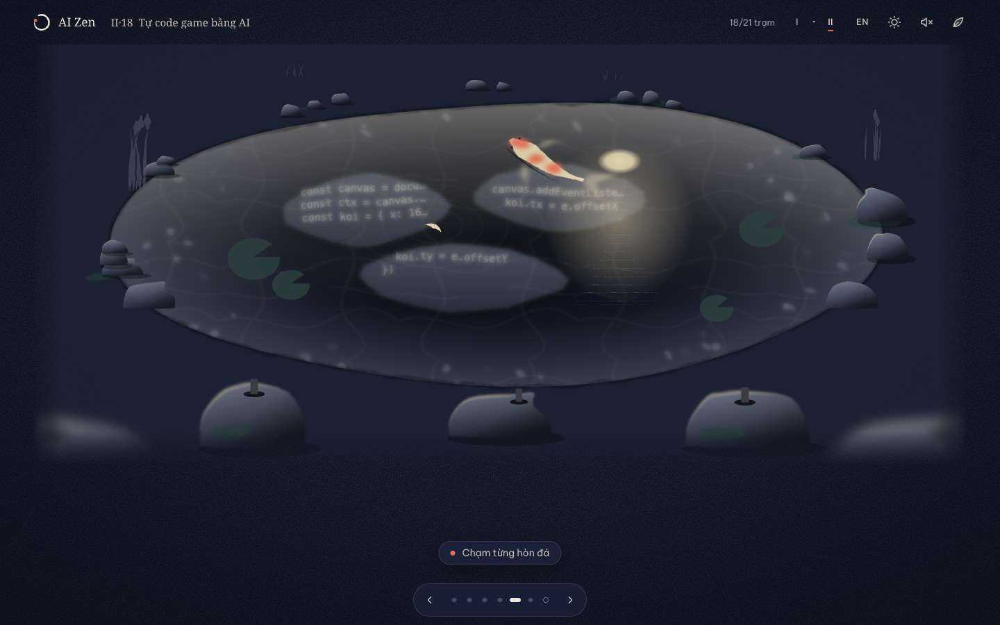
Trạng thái kết: 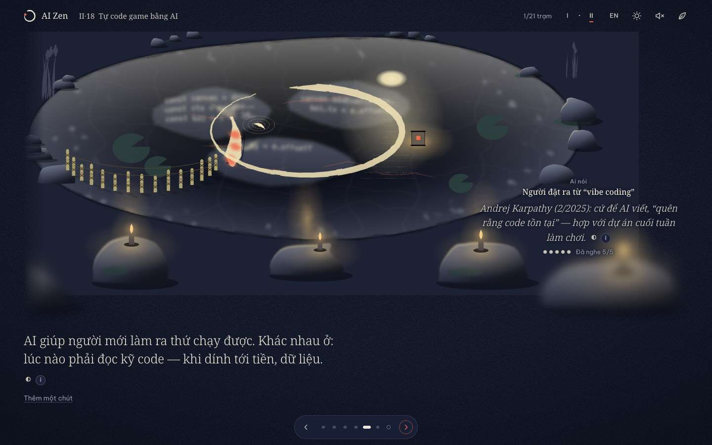
**Hiện tại**
- Thấy: hồ sâu nhìn từ trên. Mặt nước có game koi đang chạy, đáy có code viết trên các phiến đá. Mép gần có 5 hòn đá nến, mờ như ngoài nét (`t36-5-a`).
- Làm:
  - Prompt "Chạm từng hòn đá". Nến thắp, lời từng người hiện trên nước, hồ đổi theo (rào tre, đèn ấn son…).
  - Kéo lên xuống để đổi tiêu cự, nhưng cử chỉ này không được gợi ý.
  - Đủ 5 đá: hiện ensō.
- Chữ trên màn:
  - "Ai nói · Từ điển · Từ điển Collins chọn “vibe coding” là Từ của năm 2025 — cách làm này đã vào đời thường." · "Đã nghe 1/5"
  - Bốn người còn lại: "Hãng bảo mật — Veracode tự đo 80 bài trên hơn 100 model: khoảng 45% trường hợp, code AI viết có lỗ hổng bảo mật." (◇) · "Lập trình viên lâu năm — Simon Willison: nếu bạn đã đọc, chạy thử và giải thích được code, đó là lập trình bình thường, không còn là vibe coding." · "Người đặt ra từ “vibe coding” — Andrej Karpathy (2/2025): cứ để AI viết, “quên rằng code tồn tại” — hợp với dự án cuối tuần làm chơi." · "Người mới học — Game nhỏ là sân tập an toàn: hỏng thì làm lại, không ai mất tiền hay dữ liệu."
  - Insight: "AI giúp người mới làm ra thứ chạy được. Khác nhau ở: lúc nào phải đọc kỹ code — khi dính tới tiền, dữ liệu."
  - Thêm một chút: "Game hồ koi chạy trong trình duyệt, không có tài khoản hay thanh toán, nên rủi ro thấp…"

**Lỗi**
1. [GP] Cử chỉ thú vị nhất (dời tiêu cự xuống đáy để đọc code) không được gợi ý. Vết nứt Veracode không thấy rõ trên dòng code.
2. [LO] Sau khi chạm đá, lớp hồ dịch lên và sang trái khoảng 100px, lộ mép chữ nhật cứng bên phải (x≈1292) và bên dưới (y≈597) (`t36-5-d-done`). Code dưới đáy không đọc được, kể cả ở lượt Willison.
3. [CC]
   - "vibe coding" chỉ được định nghĩa gián tiếp ở viên Karpathy, và viên này lại có thể được chạm cuối cùng.
   - Nhãn "Viết theo cảm giác" mất chữ "code", nên dễ hiểu là viết văn.
   - "80 bài" mơ hồ (bài gì?).
   - Insight dùng câu khuôn "… Khác nhau ở: …", và khi đã nói "khác nhau" thì lại đưa luôn một đáp án như thể mọi người đồng ý.
   - "Người mới học" là lời AI Zen tự viết, trình bày như phát ngôn của một nhóm người.
4. [LG]
   - Câu hỏi ở nhãn ("có đủ?") không được trả lời thẳng; câu trả lời nằm rải giữa insight và "Thêm một chút".
   - Viên Collins là thông tin vụn, không phải một góc nhìn về chuyện "có đủ không".
5. [Thẩm mỹ] (TM 3) Hồ nhìn xuống có cá, lá súng, trăng phản chiếu — ổn. Nhưng:
   - Hồ là một elip tối phẳng.
   - Các phiến có code là mảng xám bo tròn như card.
   - 5 đá nến tiền cảnh mờ như placeholder.
   - Lộ mép chữ nhật của lớp sau khi chạm đá (`t36-5-d-done`).
6. [Cân bằng bố cục] (CB 3)
   - **Lúc mở:** hồ chiếm giữa (x 160–1280, y 150–590). Hàng đá nến thẳng ngang (y 560–700) dưới hồ như một hàng nút. 1/4 dưới (y 700–840) trống.
   - **Lúc kết:** lời nói ở phải giữa (x 970–1370), insight dưới trái, ensō giữa hồ — tạm cân.
7. [Hướng dẫn tương tác] Cử chỉ thật: chạm 5 đá nến; kéo dọc mặt hồ để đổi tiêu cự (ẩn).
   - Đang có: "Đã nghe n/5" sau đá đầu (H4); nến thắp (H6).
   - Đang thiếu: H1 (đá mờ trông như trang trí); cử chỉ kéo dọc không có dấu; H5 (prompt mất sau lần chạm đầu).
   - HD 2.

**Đề xuất sửa**
- Gameplay: câu mở đầu định nghĩa vibe coding trước khi chạm đá. Sau viên đầu tiên, prompt đổi sang gợi ý kéo tiêu cự. Ở lượt Willison, 3 dòng code phải đọc rõ. Vết nứt son chạy qua đúng khoảng nửa số dòng code.
- Layout: sửa lỗi lệch lớp, giữ khung cố định.
- Câu chữ viết sẵn:
  - nhãn "Code theo cảm giác có đủ không?"
  - câu mở "Vibe coding: bảo AI viết code, chạy thử, không đọc code."
  - prompt 1 "Chạm từng ngọn nến để nghe năm người" · prompt 2 "Kéo lên xuống mặt hồ để nhìn xuống đáy code"
  - Veracode "Veracode (hãng bảo mật, tự công bố): thử 80 bài tập lập trình trên hơn 100 model AI, khoảng 45% lời giải có lỗ hổng bảo mật."
  - Người mới học "Ví dụ một người mới học: “Game nhỏ là sân tập an toàn — hỏng thì làm lại, không ai mất tiền.”"
  - insight "Với game nhỏ, cứ để AI viết rồi chơi thử. Có đăng nhập, tiền hay dữ liệu người dùng thì phải có người đọc kỹ code." (24 từ)
- Thẩm mỹ:
  - Hồ có thành đá thật và độ sâu: mặt nước phản chiếu trăng, đáy xa mờ dần.
  - Code viết mực bạc trên phiến đá phẳng thật, gợn theo khúc xạ, có caustic trôi.
  - Đá nến là đá thật có sáp chảy, ngọn lửa, vũng ấm trên nước.
  - Sửa lỗi lệch lớp.
- Bố cục:
  - Hàng nến xếp thành cung theo mép hồ gần, không thẳng hàng; hai đá ngoài cùng to hơn và bị cắt mép.
  - Lời nói hiện trên nước gần đá vừa chạm. Insight đặt ở vùng nước tối trên-trái hồ.
- Hướng dẫn:
  - Mỗi nến chưa thắp có chấm son ở bấc (H1). "Đã nghe 0/5" hiện ngay từ đầu.
  - Sau đá đầu, mép phải hồ hiện thanh tiêu cự dọc có hai vạch "Mặt nước / Đáy (code)" và tay cầm chấm son (H2).
  - Prompt: "Chạm từng ngọn nến để nghe năm người" → "Kéo thanh tiêu cự xuống để đọc code dưới đáy".
  - Đứng yên 6 s: tay cầm tiêu cự nhích xuống.

### 36-Quiz · Câu hỏi nhỏ   ·   Mức: Sửa nhẹ   ·   Ưu tiên: P3
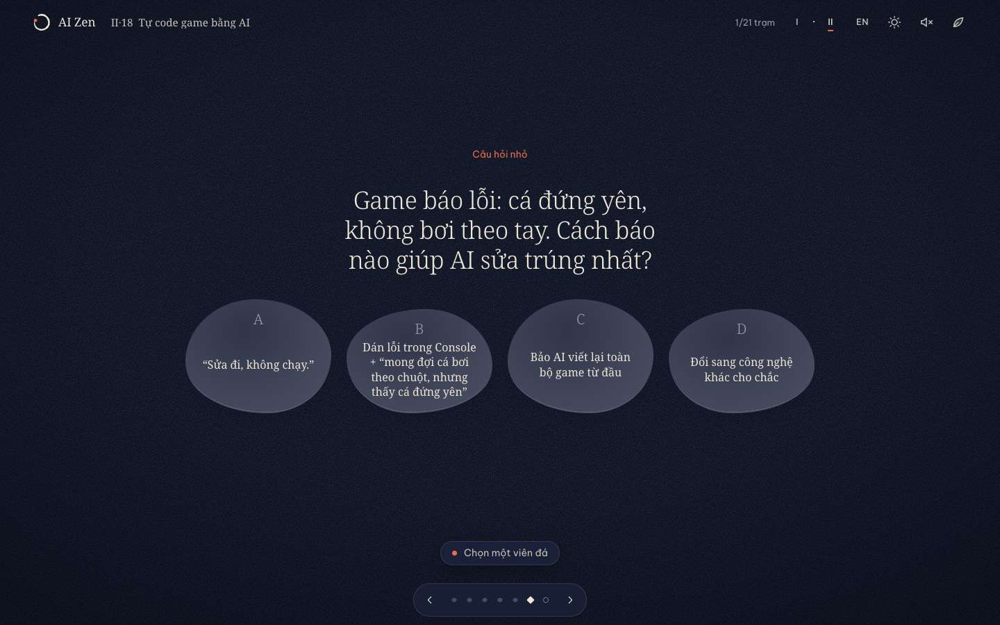
**Hiện tại**
- Chữ: "Game báo lỗi: cá đứng yên, không bơi theo tay. Cách báo nào giúp AI sửa trúng nhất?"
  - A "“Sửa đi, không chạy.”"
  - B "Dán lỗi trong Console + “mong đợi cá bơi theo chuột, nhưng thấy cá đứng yên”" (đúng)
  - C "Bảo AI viết lại toàn bộ game từ đầu"
  - D "Đổi sang công nghệ khác cho chắc"
  - Giải thích: "Bằng chứng (lỗi Console) cộng “mong đợi vs thấy” chỉ đúng chỗ hỏng; AI sửa gốc thay vì đoán mò."

**Lỗi**
1. [GP] Đáp án vẫn là B. A và D là bù nhìn.
2. [LO] ổn.
3. [CC] "Console" chưa giải thích; "vs" là tiếng Anh.
4. [LG] Quiz kiểm thẻ báo lỗi, nhưng thẻ này không được đưa ra trong trạm.
5. [Thẩm mỹ] (TM 2, em tự chấm) Cùng khuôn đá-nút xám trên nền trơn.
6. [Cân bằng bố cục] (CB 3) Như quiz 34. Đá B có 4 dòng chữ, nặng hơn ba đá còn lại.
7. [Hướng dẫn tương tác] ổn (HD 4): prompt đúng vật.

**Đề xuất sửa**
- Câu chữ viết sẵn:
  - A "Chụp màn hình gửi AI, nhắn “cá không bơi”"
  - B "Dán cả file code, nhờ AI tìm chỗ sai"
  - C "Bảo AI viết lại cả game cho sạch lỗi"
  - D "Dán dòng lỗi màu đỏ (Console, phím F12) + “mong đợi cá bơi theo chuột, nhưng thấy cá đứng yên”" (đúng)
  - Giải thích "Dòng lỗi cộng “mong đợi – thấy” chỉ đúng chỗ hỏng, nên AI sửa gốc thay vì đoán."
  - Đưa thẻ "Prompt báo lỗi chuẩn" vào vòng đẽo (36-3 mới).
- Thẩm mỹ: như quiz 34.
- Bố cục: như quiz 34; rút gọn chữ trong đá để 4 đá cân nhau.
- Hướng dẫn: giữ.

### 36-Ensō · Tóm lại trong 1 câu   ·   Mức: Giữ   ·   Ưu tiên: P3
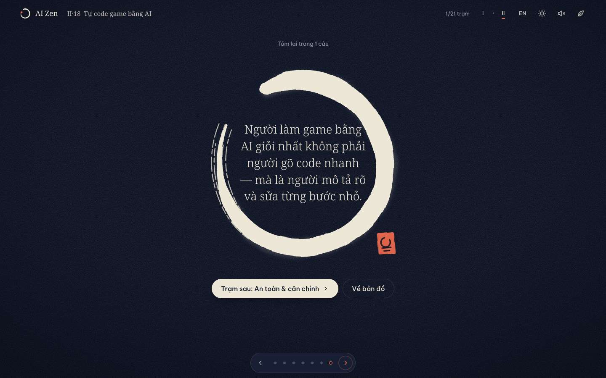
**Hiện tại**
- Chữ: "Người làm game bằng AI giỏi nhất không phải người gõ code nhanh — mà là người mô tả rõ và sửa từng bước nhỏ." Nút "Trạm sau: An toàn & căn chỉnh".

**Lỗi**
1. [GP] ổn.
2. [LO] ổn.
3. [CC] ổn (24 từ).
4. [LG] Thiếu ý "lưu mốc" và "khi nào phải đọc code" (slide 5), chấp nhận được.
5. [Thẩm mỹ] ổn (TM 4): ensō có nét cọ và ấn son.
6. [Cân bằng bố cục] ổn (CB 3): câu 5 dòng chạm sát mép trong vòng; tạm ổn.
7. [Hướng dẫn tương tác] ổn (HD 4): nút rõ.

**Đề xuất sửa**
- Giữ. Tuỳ chọn thêm dòng nhỏ dưới ensō: "4 thẻ nữa trong Hộp đồ nghề: thêm tính năng · báo lỗi · tối ưu điện thoại · trước khi đăng."
- Thẩm mỹ: giữ.
- Bố cục: rút câu còn 4 dòng, hoặc nới vòng ensō 10%.
- Hướng dẫn: giữ.

---

## Bảng tóm tắt vườn

| Slide | Mức | Ưu tiên | TM | CB | HD | Lỗi chính | Sửa chính |
|---|---|---|---|---|---|---|---|
| 34-1 Chợ đêm | Sửa nhẹ | P1 | 3 | 3 | 3 | Sạp gom hợp cả 4 việc, trái insight; insight bị mũi thuyền che | Mỗi sạp thắng ít nhất 1 việc, hợp có 2 mức (rực/mờ); dời insight |
| 34-2 Đường đi asset | Làm lại | P2 | 2 | 2 | 2 | Quiz xếp đá, số trên đá gây nhầm; dùng "credit" trước khi dạy | 3 ngã rẽ có hậu quả (tốn nước / lạc / mất bài) |
| 34-3 Bình credit | Sửa nhẹ | P1 | 4 | 3 | 2 | "Bình cạn" khi còn 29; insight trước khi so; "tín dụng"; phone không có nhãn | Insight sau khi so 5 với 33; sửa thông báo; khắc nhãn lên vật |
| 34-4 Thật và giả | Sửa nhẹ | P2 | 3 | 3 | 2 | Vuốt nước không được gợi ý; insight không khớp lời nghe, câu khuôn | Prompt vuốt trước; ấn son lên bóng; insight mới |
| 34 Quiz | Sửa nhẹ | P3 | 2 | 3 | 4 | Đáp án B, nhiễu bù nhìn; hỏi "nhạc" chưa dạy | Đổi vị trí, nhiễu hợp lý |
| 34 Ensō | Sửa nhẹ | P2 | 4 | 4 | 4 | Chỉ ẩn dụ "cây đục" không có trên slide; thiếu quyền/nhãn | Câu thật: nền tảng · credit · nhãn |
| 35-1 Bậc thang | Làm lại | P1 | 2 | 2 | 2 | Workflow đặt trên Agent, trái nguồn; hook bị hiểu là hẹn giờ; không có quyết định | Kéo việc lên bậc vừa đủ; đổi thứ tự; hook thành ống tre bên cạnh |
| 35-2 Cuộn skill | Sửa nhẹ | P2 | 4 | 3 | 3 | Người xem đi tìm thay cho AI; EN sót "progressive disclosure" | AI (đèn) tìm theo mô tả; chọn mô tả mơ hồ hay rõ |
| 35-3 Thói quen → chuẩn | Làm lại | P2 | 2 | 2 | 4 | Thanh trượt đọc lịch sử, mốc lạc đề | Kéo cuộn sang công cụ khác, hoặc cắt |
| 35-4 Spec trước | Làm lại | P2 | 3 | 2 | 2 | Sai trạm (thuộc t36), quiz xếp đá, kết thúc bàn trống, thẻ giấu trên móc | "Viết skill từ một lần làm tốt" |
| 35-5 Dây chuyền | Sửa nhẹ | P1 | 4 | 3 | 1 | Click đèn hỏng, halo nuốt chạm, thuyền tự chạy rồi khoá đặt đá | Sửa chạm; nút "Thả thuyền"; hậu quả cụ thể tại trạm |
| 35 Quiz | Sửa nhẹ | P3 | 2 | 3 | 4 | Đáp án B | Đổi vị trí, nhiễu hợp lý |
| 35 Ensō | Giữ | P3 | 4 | 4 | 4 | Thiếu ý người duyệt | Tuỳ chọn câu mới |
| 36-1 Bản vẽ | Sửa nhẹ | P2 | 3 | 2 | 3 | Không có đối chứng mơ hồ/rõ; bóng cuối không ra game; "spec sống" | Dải mơ hồ ↔ rõ; bóng thành khung game; thêm 2 dòng |
| 36-2 Chọn bút | Giữ | P3 | 5 | 4 | 4 | "Ngón tay cái" dịch máy; camera che hồ | "Mẹo chọn nhanh"; giới hạn góc xoay |
| 36-3 Bảy bước | Làm lại | P2 | 3 | 3 | 2 | Git chỉ 1 viên ở vị trí 6, trái "sau mỗi bước"; lệnh kỹ thuật chưa giải thích | Vòng đẽo có mốc + "Quay về mốc trước" |
| 36-4 Từng lớp | Sửa nhẹ | P2 | 2 | 2 | 3 | Câu dặn lớp 4–5 gộp nhiều việc, nhắc tim trước khi có | 7 lớp mỗi lớp một việc; thả sai thì thấy hỏng |
| 36-5 Vibe coding | Sửa nhẹ | P2 | 3 | 3 | 2 | Lộ mép lớp; câu khuôn; không định nghĩa vibe coding | Sửa lớp; câu mở định nghĩa; insight trả lời thẳng |
| 36 Quiz | Sửa nhẹ | P3 | 2 | 3 | 4 | Đáp án B; thẻ báo lỗi không có trong trạm | Đổi vị trí; đưa thẻ vào slide |
| 36 Ensō | Giữ | P3 | 4 | 3 | 4 | — | Tuỳ chọn dòng "4 thẻ nữa" |

## Top 5 việc nên làm ở vườn này
1. **Sửa 5 chỗ đang dạy sai** (P1/P2): dữ liệu sạp gom luôn đúng (34-1); thứ tự Workflow/Agent và hook bị hiểu là hẹn giờ (35-1); "Bình cạn" khi còn 29 (34-3); git chỉ một lần (36-3); câu dặn gộp nhiều tính năng (36-4).
2. **Sửa lỗi chặn và lỗi hiển thị**: chạm/click đèn và thuyền tự chạy (35-5); đồ vật không nhãn và khung trượt ngang trên phone (34-3); insight bị tranh che (34-1, 34-4); lộ mép lớp (36-5); bóng giấy còn sót và thẻ giấu trên móc (35-4).
3. **Thay 3 quiz xếp đá bằng luật chơi có hậu quả**: 34-2 thành 3 ngã rẽ; 35-4 thành viết skill từ một lần làm tốt; 36-3 thành vòng đẽo có mốc. Ít nhất phải bỏ số phím tắt trên đá.
4. **Sắp lại mạch**:
   - t34: credit trước đường đi.
   - t35: bắt đầu bằng một skill cụ thể; chuyển ý spec sang t36; cắt hoặc đổi 35-3.
   - t36: gộp 36-3 với 36-4.
   - Đưa các thẻ mang về đang mồ côi vào đúng slide, và cho quiz kiểm đúng điều slide đã dạy.
5. **Làm sạch câu chữ**:
   - Giải mã thuật ngữ và ẩn dụ tại chỗ: credit ≠ tín dụng; model; spec; npm, git, Vite; vibe coding; "cây đục".
   - Bỏ câu khuôn "Đều đồng ý… Khác nhau ở…" (34-4, 36-5).
   - Bỏ văn dịch máy ("Ngón tay cái", "ý định là gốc", "spec sống") và tiếng Anh sót ("asset", "progressive disclosure", "prompt khổng lồ").
   - Đổi vị trí đáp án quiz (cả 3 trạm đều là B).

## Thẩm mỹ, cân bằng và hướng dẫn của vườn
Mặt bằng của vườn (TM / CB trung bình, chỉ tính slide nội dung): t34 3,0 / 2,8 · t35 3,0 / 2,4 · t36 3,2 / 2,8. Khớp calibration (vườn 12 là 3,1 / 2,7). Hướng dẫn trung bình là 2,5 — thấp nhất trong ba chỉ số.

5 việc ưu tiên:
1. **Bỏ "đá-nút, phiến chữ, chip" và thay bằng vật thật có chữ khắc.**
   - Chỗ cần sửa: 34-2, 35-1, 35-4, 36-3 (đá hoặc phiến xếp hàng), chip dưới bàn ở 34-3, đá A–D của cả 3 quiz, tấm tên ở 35-5, dải và tag dạng card ở 36-1, 36-2.
   - Mẫu cần học: bình men của 34-3 và ống bút của 36-2 — vật có khối và chất liệu thật, chữ nằm *trên* vật (khắc, mực, giấy treo), không nằm trong ô.
2. **Mỗi cảnh có một hero rõ và một nguồn sáng trăng thống nhất.**
   - 36-1: đèn andon chỉ chiếm 3% khung.
   - 35-3: không có hero.
   - 36-4: chồng giấy rối.
   - 34-2: đèn đá đích tí hon.
   - 34-4: người mẫu tí hon.
   - Cách sửa: đưa hero lên khoảng 15–25% khung, học ánh sáng của 26-1 (trăng sau lưng, viền sáng mép vật, vũng ấm của đèn).
3. **Quy định vùng đặt chữ cho từng slide.**
   - Hiện tại insight luôn nằm cố định ở dưới trái và đè lên tranh: 34-1 (mũi thuyền), 34-4 (đá đèn); và 35-2, 35-3 làm lệch khung về trái.
   - Mỗi slide cần có sẵn một vùng trống cho insight, kiểu "nước trống dưới giữa" hay "vách trên phải".
   - Thẻ mang về thu thành một vật nhỏ (mảnh giấy, cuộn), chỉ mở khi chạm. Hiện thẻ đang che 1/3 khung ở 34-2 và 36-3, và fact che hero ở 35-5.
4. **Một bộ dấu hướng dẫn chung kiểu Phần 1 cho cả vườn.**
   - Chấm son kèm vầng thở trên vật kế tiếp: hiện mới có ở 36-4, cần nhân ra mọi slide.
   - Bộ đếm "n/N" hiện ngay từ đầu.
   - Rãnh hoặc đích sáng lên khi nhấc vật.
   - Prompt đổi theo từng bước và **không biến mất khi chạm hụt** (sửa `station.ts:153`: hiện `art` pointerdown nào cũng gọi `hidePrompt`).
   - Gợi ý khi đứng yên 6 s: `frameHint` của 36-2 là mẫu có sẵn.
5. **Cử chỉ ẩn: thêm dấu nhìn thấy, hoặc bỏ hẳn. Đồng thời đưa mọi vùng chạm lên ≥ 44px.**
   - Cử chỉ ẩn hiện có: vuốt nước (34-4), kéo dọc để leo (35-1), xoay đèn (36-1), xoay chồng giấy (36-4), kéo tiêu cự (36-5), kéo đèn làm việc (36-3), vẽ nét nối đèn (35-5).
   - Vùng chạm đang nhỏ:
     - bậc 15–27px (35-1);
     - đế đá 40×16 (35-5);
     - chip 21px (34-3);
     - nút 40×28 và 30×36 (36-4);
     - ấn son 19×19 (35-1).

## Đổi so với v2
- **Mức / Ưu tiên:** không đổi slide nào. Các lỗi thẩm mỹ, cân bằng, hướng dẫn mới tìm thấy đều nằm trong những slide đã xếp Làm lại hoặc P1/P2.
  - Ngoại lệ đáng chú ý: 34-4 (HD 2) và 36-5 (HD 2) vẫn giữ P2, nhưng nên làm cùng đợt với P1, vì cử chỉ chính của hai slide đang bị ẩn.
- **Lệch so với calibration.md:** chỉ một chỗ. 35-4 CB 3 → 2: calibration chấm ảnh lúc mở, còn trạng thái kết là một mặt bàn tối trống với cuộn skill nhỏ ở mép phải (`g12/t35-4-d-done.jpg`). Mọi slide nội dung khác giữ đúng TM/CB của calibration.
- **Quiz và ensō:** calibration không chấm; TM/CB/HD của các mục này là em tự chấm.
